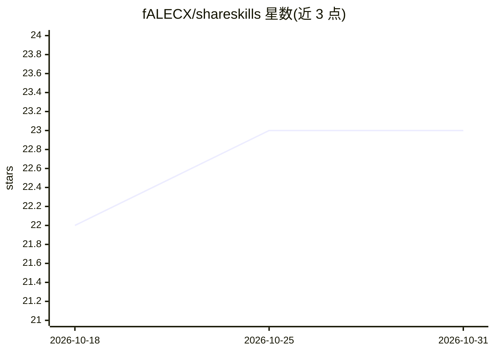

# fALECX/shareskills

⭐ 23 · JavaScript · ISC · 推送 2026-03-05 · [GitHub](https://github.com/fALECX/shareskills) · 个人维护

**跨 IDE 同步 AI agent 技能与自定义指令的 CLI 工具**

npm 全局安装的命令行工具，将 Cursor、Windsurf、Antigravity、Claude Code 等 AI 工具各自的 skills / 自定义指令文件夹整合到一个中央 Hub：合并现有技能、把原文件夹备份后替换为符号链接（Windows 用 junction），使任一工具中的修改即时反映到其他工具。预配置多个主流 agent，支持手动添加自定义目录，操作前自动备份。

## 筛选速览

| 维度 | 判定 | 备注 |
|---|---|---|
| AI 角色 | `ai-ecosystem` | LLM/agent 周边工具 |
| 许可风险 | `permissive` | ISC |
| 部署形态 | `library` | 以包/库形式分发 |
| 模型依赖 | — | README 未给出锁定关系 |
| 硬件要求 | — | 无带数字的原话,不猜 |
| 安装摩擦 | `low` | 无编译、无系统依赖或容器化 |
| 成熟度 | — | 结构信号不足 |

## 能力要点

- 将各 AI 工具的技能文件夹合并到单一中央 Hub
- 用符号链接替换原目录，改动即时同步到所有工具
- 预配置 Antigravity / Cursor / Windsurf / Claude Code 等工具
- 改动前自动创建 .backup_ 时间戳备份

## 适用场景

- 在多个 AI IDE 之间维护同一套技能和指令，避免手动复制
- 统一管理分散在各工具下的 agent skills 目录
- 把自定义路径的技能目录纳入集中同步

## 场景标签

 · 领域:开发者工具/AI 工作流管理

## 证据(README 行号)

> L3: Synchronize AI agent skills and custom instructions across different IDEs and tools (Cursor, Windsurf, Antigravity, 
> L9: **ShareSkills** connects all your AI tools to a single, shared folder (The Hub).

## 星数曲线

2026-10-18 22 → 2026-10-31 23（+1）

---
*卡片 v1 · prompt 1.4 · 生成 2026-10-27 · 置信度 high · 依据 README sha `20f2a1d80953` · [字段定义](../../DATASET.md)*
