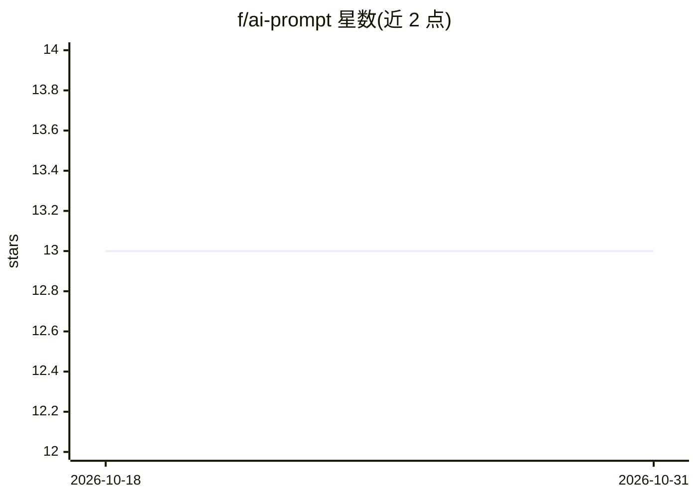

# f/ai-prompt

⭐ 13 · JavaScript · GPL-2.0 · 推送 2026-08-20 · [GitHub](https://github.com/f/ai-prompt) · [官网](https://github.com/f/ai-prompt) · 个人维护

**在 WordPress 文章中展示 AI 提示词的 Gutenberg 区块**

原生 WordPress Gutenberg 区块，用于在教程、文档、博文中内嵌展示 AI 提示词：渲染模型徽章、模式（Chat/Code/Ask/Plan）、指示器、按前缀分类的上下文 chips、文件树侧栏、diff 视图、MCP 工具行、Run 链接下拉与复制按钮。不使用 iframe、无第三方请求，输出为主题化 HTML 存入 post_content，仅一段剪贴板前端脚本。Run 下拉为纯链接，区块本身不执行命令。通过 Releases 的 zip 或源码（npm ci && npm run build）安装。

## 筛选速览

| 维度 | 判定 | 备注 |
|---|---|---|
| AI 角色 | `ai-enhanced` | 去掉 AI 部分产品仍成立 |
| 许可风险 | `viral` | GPL-2.0 |
| 部署形态 | `desktop` | 安装包/桌面程序 |
| 模型依赖 | — | README 未给出锁定关系 |
| 硬件要求 | — | 无带数字的原话,不猜 |
| 安装摩擦 | `low` | 无编译、无系统依赖或容器化 |
| 成熟度 | — | 结构信号不足 |

## 能力要点

- 渲染模型/模式徽章、指示器与按前缀分类的上下文 chips
- 可选文件树、diff 视图与 MCP 工具行
- 无 iframe、零外部请求，序列化为真实 HTML 存入 post_content
- Run 按钮生成到 ChatGPT/Claude/Cursor 等工具的纯链接，可自定义目标

## 适用场景

- 教程与博文中原样展示 AI 提示词及模型、模式上下文
- 提示词工程对比多个变体并标注各自模型
- 产品文档中给出用户可复制的示例提示词
- 发布说明中用提示词嵌入替代截图

## 场景标签

 · 领域:内容发布/WordPress 插件

## 证据(README 行号)

> L8: A native WordPress block that displays AI prompts the way they're meant to be seen — with the model, mode, context c
> L57: - An optional single Run button with a small dropdown of relevant tools (ChatGPT, Claude, Cursor, GitHub Copilot, v

## 星数曲线

2026-10-18 13 → 2026-10-31 13（+0）

---
*卡片 v1 · prompt 1.4 · 生成 2026-10-31 · 置信度 mid · 依据 README sha `7bf22b4f7f81` · [字段定义](../../DATASET.md)*
