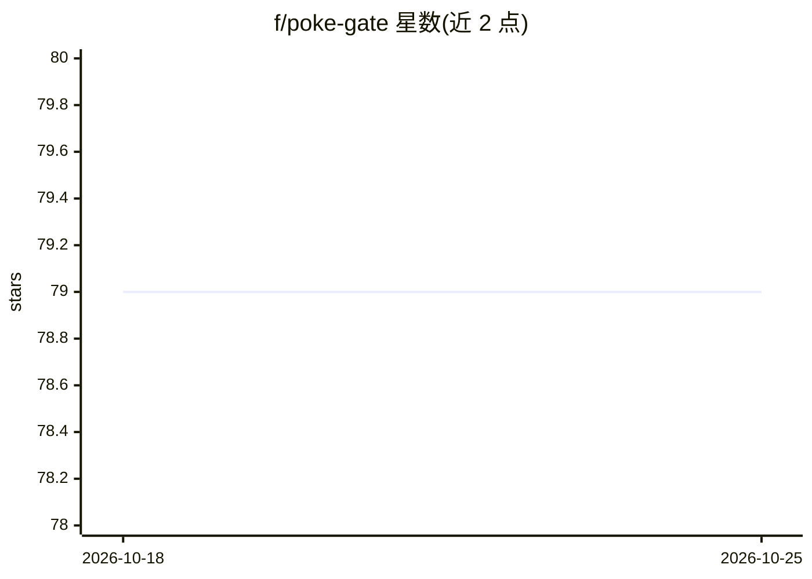

# f/poke-gate

⭐ 79 · JavaScript · MIT · 推送 2026-07-10 · [GitHub](https://github.com/f/poke-gate) · [官网](http://poke-gate.fka.dev/) · 个人维护

**把本机通过 MCP 隧道暴露给 Poke AI 助手的工具**

在本地运行 MCP 服务器并隧道连接到 Poke 云端：用户从 iMessage、Telegram 或 SMS 向 Poke 助手发消息，助手调用 MCP 工具在本机执行 shell 命令、读写文件、列出目录、截屏与查看系统信息。提供 7 个工具与 Full/Limited/Sandbox 三种访问模式（Sandbox 用 macOS sandbox-exec 限制写入），另有定时运行的 JS 后台 agent 机制。以 npm CLI 与 SwiftUI 菜单栏应用（macOS 15+）两种形式提供，需 Node.js 18+ 与 Poke OAuth 登录。社区项目，非 Poke 官方。

## 筛选速览

| 维度 | 判定 | 备注 |
|---|---|---|
| AI 角色 | `ai-ecosystem` | LLM/agent 周边工具 |
| 许可风险 | `permissive` | MIT |
| 部署形态 | `desktop` | 安装包/桌面程序 |
| 模型依赖 | — | README 未给出锁定关系 |
| 硬件要求 | — | 无带数字的原话,不猜 |
| 安装摩擦 | `low` | 无编译、无系统依赖或容器化 |
| 成熟度 | — | 结构信号不足 |

## 能力要点

- 本地 MCP server 隧道至 Poke 云端，经 iMessage/Telegram/SMS 对话操控本机
- run_command/read_file/write_file/take_screenshot 等 7 个工具
- Full/Limited/Sandbox 三档访问模式，Sandbox 经 sandbox-exec 限制写入
- 按命名约定定时执行的后台 agent（JS 脚本 + 独立 env 文件）

## 适用场景

- 通过聊天让 Poke 助手在本机跑命令、读文件、截图
- 让 AI 助手查看 git 提交、磁盘占用等项目状态
- 定时运行备份、健康检查等自动化脚本 agent

## 场景标签

`工作流自动化` · 领域:效率与自动化

## 证据(README 行号)

> L5:  Let your Poke AI assistant access your machine.
> L75: Poke Gate runs a local MCP server and tunnels it to Poke's cloud. When you ask Poke something that needs your machi

## 星数曲线

2026-10-18 79 → 2026-10-25 79（+0）

---
*卡片 v1 · prompt 1.4 · 生成 2026-10-24 · 置信度 high · 依据 README sha `e2d4d79a306a` · [字段定义](../../DATASET.md)*
