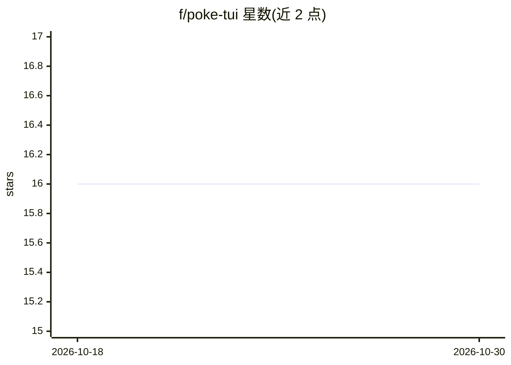

# f/poke-tui

⭐ 16 · JavaScript · 推送 2026-05-29 · [GitHub](https://github.com/f/poke-tui) · 个人维护

**在终端里与 Poke AI 助手对话的 TUI 客户端**

基于 Ink（React for CLIs）与 Poke SDK 构建的终端聊天界面，通过 Poke API 连接用户的 Poke agent，在终端内收发消息，无需切换到 iMessage/Telegram/SMS。机制上：本地运行一个实现 MCP 协议的轻量 HTTP 服务器，经 WebSocket 隧道（PokeTunnel）打通到 Poke 云端，agent 可调用 reply_to_terminal 工具将回复直接送回终端。通过 npx 一键运行，首次运行引导粘贴 API key；支持 /webhook 命令创建触发器，用 JSON 数据驱动 agent。要求 Node.js 18+ 与 Poke 账号 API key。

## 筛选速览

| 维度 | 判定 | 备注 |
|---|---|---|
| AI 角色 | `ai-ecosystem` | LLM/agent 周边工具 |
| 许可风险 | `none` | — |
| 部署形态 | `library` | 以包/库形式分发 |
| 模型依赖 | — | README 未给出锁定关系 |
| 硬件要求 | — | 无带数字的原话,不猜 |
| 安装摩擦 | `low` | 无编译、无系统依赖或容器化 |
| 成熟度 | — | 结构信号不足 |

## 能力要点

- 本地 MCP 服务器 + PokeTunnel WebSocket 隧道，agent 可直接回复到终端
- /webhook 命令创建自动化触发器并以 JSON 数据调用 agent
- npx 一键运行，首次运行引导式 API key 配置，密钥存于 ~/.config/poke-tui/config.json

## 适用场景

- 在终端中直接与自己的 Poke AI 助手对话
- 通过 webhook 触发让 agent 自动总结部署失败并给出建议
- 不想切换到 iMessage/Telegram 而在开发环境内完成 AI 对话

## 场景标签

`AI 助手` · 领域:对话与助手

## 证据(README 行号)

> L3: A terminal UI for Poke — chat with your AI assistant without leaving the terminal.
> L5: Built with Ink (React for CLIs) and the Poke SDK.
> L17: **poke-tui** connects to your Poke agent through the Poke API. You type messages in the terminal, and Poke responds

## 星数曲线

2026-10-18 16 → 2026-10-30 16（+0）

---
*卡片 v1 · prompt 1.4 · 生成 2026-10-30 · 置信度 high · 依据 README sha `561081f90e96` · [字段定义](../../DATASET.md)*
