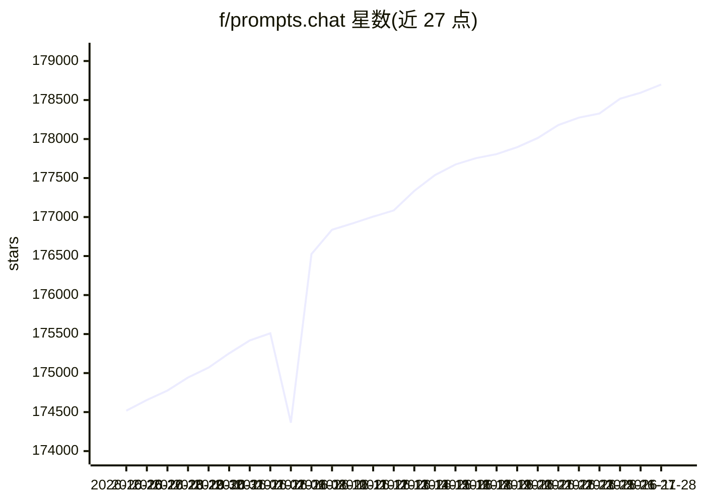

# f/prompts.chat

⭐ 178,699 · MDX · NOASSERTION · 推送 2026-11-27 · [GitHub](https://github.com/f/prompts.chat) · [官网](https://prompts.chat) · 个人维护

**面向 AI 用户的开源提示词库：浏览、分享与自托管提示词**

原 Awesome ChatGPT Prompts，现为一套提示词集合与配套站点：以 prompts.csv、PROMPTS.md、Hugging Face Dataset 等格式分发社区贡献的提示词，并托管 bots 与 bot teams 目录、MCP Server、CLI 与 Claude Code 插件入口。支持通过 npx 脚手架或 git clone 自托管私有提示词库，向导配置品牌、主题与 GitHub/Google/Azure AD 认证，依赖 PostgreSQL。附免费交互式提示工程教程（31+ 章、17 种语言）及儿童提示游戏。

## 筛选速览

| 维度 | 判定 | 备注 |
|---|---|---|
| AI 角色 | `ai-knowledge` | 知识聚合/清单类 |
| 许可风险 | `none` | NOASSERTION |
| 部署形态 | `library` | 以包/库形式分发 |
| 模型依赖 | — | README 未给出锁定关系 |
| 硬件要求 | — | 无带数字的原话,不猜 |
| 安装摩擦 | `low` | 无编译、无系统依赖或容器化 |
| 成熟度 | — | 结构信号不足 |

## 动量与使用信号

- 维护:`active` — 距上次 push 1.2 天,年发版 0,300 位贡献者
- 涨星:近 1 天 **+126**(自 20261016 起算)
- 安装:npm 包 `prompts.chat` 月下载 3,118
- 平台:— · 协议:MCP

## 能力要点

- 以 CSV、Markdown、Hugging Face Dataset 多格式分发提示词数据
- 可作为 MCP Server 接入 AI 工具，覆盖 prompts/skills/bots/teams 工具
- npx prompts.chat 自托管，配置自定义品牌与认证
- 社区贡献通过 prompts.chat/prompts/new 自动同步

## 适用场景

- 为 ChatGPT/Claude/Gemini 等助手查找可用提示词
- 为组织自托管私有提示词库并保留数据隐私
- 在 Claude Code 等工具中通过插件/MCP 调用提示词
- 查阅提示工程入门到进阶的交互式教程

## 场景标签

`提示工程` `教程课程` `精选清单` · 领域:Agent 开发

## 证据(README 行号)

> L8:  The world's largest open-source prompt library for AI
> L40: A curated collection of **prompts** for AI chat models. Originally created for ChatGPT, these prompts work great wi

## 星数曲线

2026-10-26 174,517 → 2026-11-28 178,699（+4,182）

---
*卡片 v1 · prompt 1.4 · 生成 2026-11-22 · 置信度 high · 依据 README sha `4ca2b1cdc953` · [字段定义](../../DATASET.md)*
