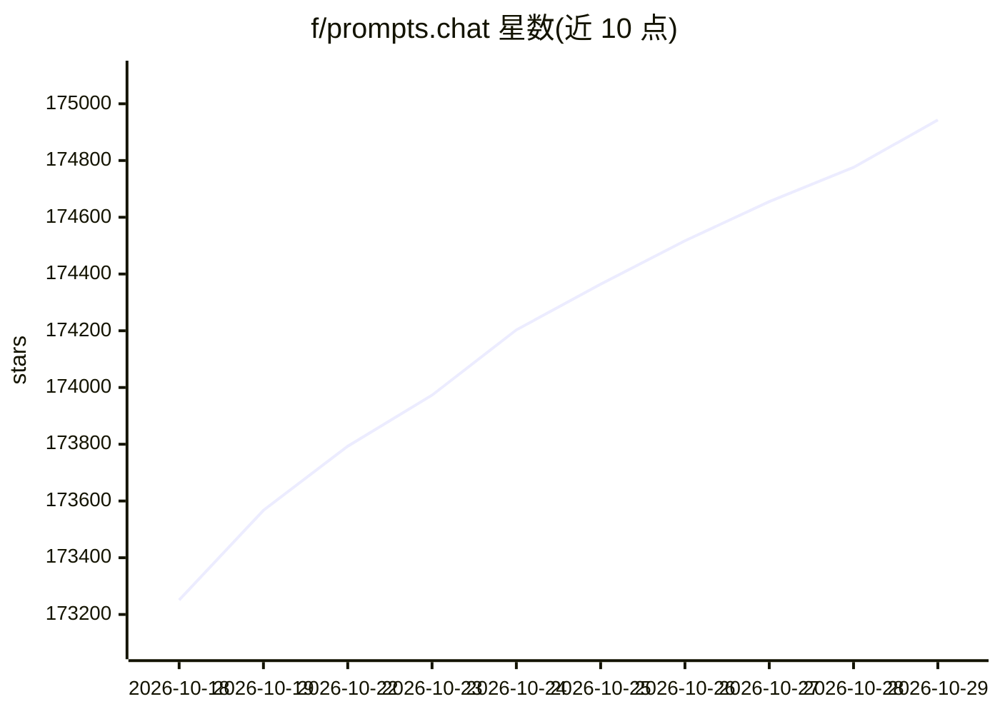

# f/prompts.chat

⭐ 174,943 · HTML · NOASSERTION · 推送 2026-10-28 · [GitHub](https://github.com/f/prompts.chat) · [官网](https://prompts.chat) · 个人维护

**给 AI 用户的社区开源提示词库，可浏览、收藏与自托管**

一个社区共建的提示词集合（前身为 Awesome ChatGPT Prompts），提供网站浏览与 CSV、Markdown、Hugging Face Dataset 三种数据格式，用户可通过网站提交提示词并自动同步。支持用 npx/npm 自托管私有提示词库，含品牌、主题与 GitHub/Google/Azure AD 认证配置向导，数据库使用 PostgreSQL。另提供 CLI、Claude Code 插件与 MCP Server 三种接入方式，并附免费交互式提示工程教程与儿童学习模块。

## 筛选速览

| 维度 | 判定 | 备注 |
|---|---|---|
| AI 角色 | `ai-ecosystem` | LLM/agent 周边工具 |
| 许可风险 | `dual` | NOASSERTION |
| 部署形态 | `library` | 以包/库形式分发 |
| 模型依赖 | — | README 未给出锁定关系 |
| 硬件要求 | — | 无带数字的原话,不猜 |
| 安装摩擦 | `low` | 无编译、无系统依赖或容器化 |
| 成熟度 | `idea` | |

## 动量与使用信号

- 维护:`active` — 距上次 push 1.2 天,年发版 0,300 位贡献者
- 涨星:近 1 天 **+126**(自 20261016 起算)
- 安装:npm 包 `prompts.chat` 月下载 3,118
- 平台:— · 协议:MCP

## 能力要点

- 提示词数据以 CSV、PROMPTS.md、Hugging Face Dataset 发布
- npx prompts.chat 一键创建自托管库，支持 GitHub/Google/Azure AD 认证
- 提供 CLI、Claude Code 插件与 MCP Server 接入
- 附 28+ 章交互式提示工程教程

## 适用场景

- 给组织自托管一个私有提示词库
- 为 ChatGPT/Claude/Gemini 等助手查找现成提示词
- 把提示词库作为 MCP server 接入自己的 AI 工具

## 场景标签

`提示工程` `精选清单` `教程课程` · 领域:Agent 开发

## 证据(README 行号)

> L40: A curated collection of **prompts** for AI chat models. Originally created for ChatGPT, these prompts work great wi
> L67: ## 🚀 Self-Hosting
> L111: ### MCP Server
> L191: This project is dual-licensed:

## 星数曲线

2026-10-18 173,251 → 2026-10-29 174,943（+1,692）

---
*卡片 v1 · prompt 1.4 · 生成 2026-10-18 · 置信度 high · 依据 README sha `3ca0e06a0ec0` · [字段定义](../../DATASET.md)*
