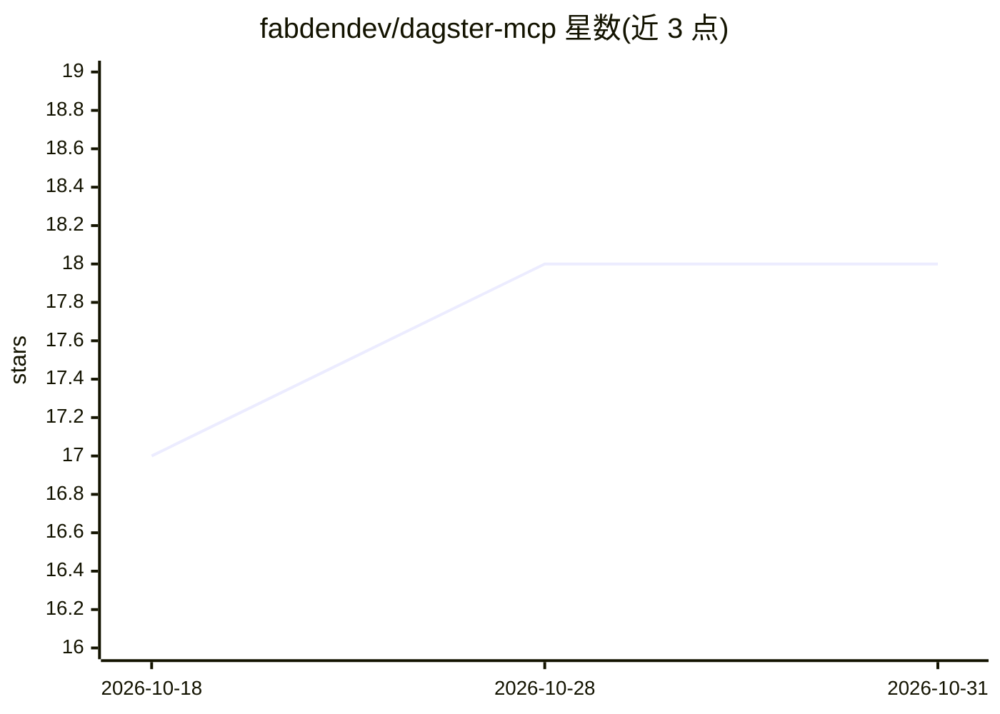

# fabdendev/dagster-mcp

⭐ 18 · Python · MIT · 推送 2026-09-28 · [GitHub](https://github.com/fabdendev/dagster-mcp) · 个人维护

**封装 Dagster GraphQL API 的 MCP server，供 AI agent 运维数据管道**

面向自托管/开源 Dagster 用户的 MCP server：把 Dagster GraphQL API 包装为 27 个工具、6 类操作，覆盖 runs、assets、jobs、schedules/sensors、实例健康检查及写操作（物化资产、backfill、启动/终止 job、启停 schedule/sensor、reload 代码位置）。写操作默认关闭，需设 DAGSTER_READ_ONLY=false 启用；支持多实例配置，可接入 Claude Code、Claude Desktop、Cursor 等 MCP client。以 PyPI 包、uvx 或源码方式运行，部分工具要求 Dagster 1.9+。

## 筛选速览

| 维度 | 判定 | 备注 |
|---|---|---|
| AI 角色 | `ai-ecosystem` | LLM/agent 周边工具 |
| 许可风险 | `permissive` | MIT |
| 部署形态 | `library` | 以包/库形式分发 |
| 模型依赖 | — | README 未给出锁定关系 |
| 硬件要求 | — | 无带数字的原话,不猜 |
| 安装摩擦 | `low` | 无编译、无系统依赖或容器化 |
| 成熟度 | — | 结构信号不足 |

## 能力要点

- 27 个工具覆盖监控与操作，含失败诊断汇总与资产健康视图
- 写操作默认只读，通过 DAGSTER_READ_ONLY=false 显式开启
- 支持 DAGSTER_ENVS 配置多实例，工具可按 env 参数定向
- 主要面向官方 MCP server 文档化方案未覆盖的自托管 Dagster

## 适用场景

- 让 AI agent 监控并诊断 Dagster 数据管道故障
- 通过对话执行资产物化、分区 backfill 与 job 启动
- 检测 schedule/sensor 的静默失败与 tick 历史

## 场景标签

`MLOps` · 领域:训练与推理

## 证据(README 行号)

> L9: An MCP server that gives AI agents full visibility and control over your Dagster instance — like an SRE for your dat
> L11: Works with any MCP client: Claude Code, Claude Desktop, Cursor, and more.
> L291: Dagster builds and supports its own AI tooling. If you are a **Dagster+ customer**, start with theirs — it is firs

## 星数曲线

2026-10-18 17 → 2026-10-31 18（+1）

---
*卡片 v1 · prompt 1.4 · 生成 2026-10-29 · 置信度 high · 依据 README sha `69bc6e697bfd` · [字段定义](../../DATASET.md)*
