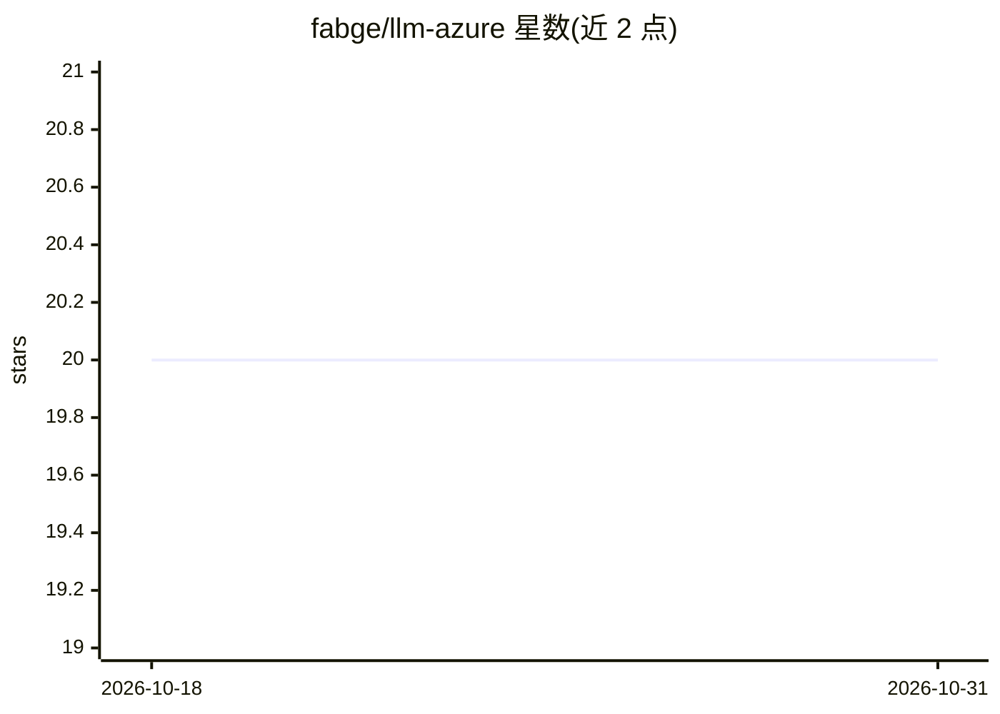

# fabge/llm-azure

⭐ 20 · Python · Apache-2.0 · 推送 2026-09-20 · [GitHub](https://github.com/fabge/llm-azure) · [官网](https://pypi.org/project/llm-azure/) · 个人维护

**为 LLM CLI 提供 Azure AI Foundry 模型接入与 Entra ID 认证的插件**

Simon Willison 的 LLM 工具的插件，用于通过 Azure AI Foundry 访问模型。核心补充两点：用 `az login` 的 Entra ID 认证替代 API key 管理，以及通过 Azure 访问 Anthropic Claude 模型（需安装 anthropic 扩展）。通过 YAML 配置文件定义模型（model_id/provider/model_name/endpoint 等字段），provider 支持 openai（GPT、Mistral、DeepSeek、Llama 等）与 anthropic（Claude）两类，使用各自官方 SDK。也保留可选的 API key 认证方式。面向已在 Azure 上部署模型并使用 LLM CLI 的开发者。

## 筛选速览

| 维度 | 判定 | 备注 |
|---|---|---|
| AI 角色 | `ai-ecosystem` | LLM/agent 周边工具 |
| 许可风险 | `permissive` | Apache-2.0 |
| 部署形态 | `library` | 以包/库形式分发 |
| 模型依赖 | locked-api |  |
| 硬件要求 | — | 无带数字的原话,不猜 |
| 安装摩擦 | `low` | 无编译、无系统依赖或容器化 |
| 成熟度 | — | 结构信号不足 |

## 能力要点

- Entra ID 认证，用 az login 替代 API key 管理
- 通过 Azure AI Foundry 访问 Anthropic Claude 模型
- 支持 openai 与 anthropic 两类 provider 及多模型别名配置
- 保留可选 api_key_name 的 API key 认证路径

## 适用场景

- 企业 Azure 环境下用 LLM CLI 调用 GPT/DeepSeek/Llama 等模型
- 通过 Azure 端点使用 Claude 模型且不手动管理 API key
- 在多个 Azure 部署模型间用别名快速切换

## 场景标签

`模型网关` · 领域:Agent 开发

## 证据(README 行号)

> L7: LLM plugin for Azure AI Foundry.
> L15: - **Entra ID authentication** - Use `az login` instead of managing API keys
> L16: - **Claude models on Azure** - Access Anthropic models through Azure AI Foundry

## 星数曲线

2026-10-18 20 → 2026-10-31 20（+0）

---
*卡片 v1 · prompt 1.4 · 生成 2026-10-28 · 置信度 high · 依据 README sha `c3b02e7af093` · [字段定义](../../DATASET.md)*
