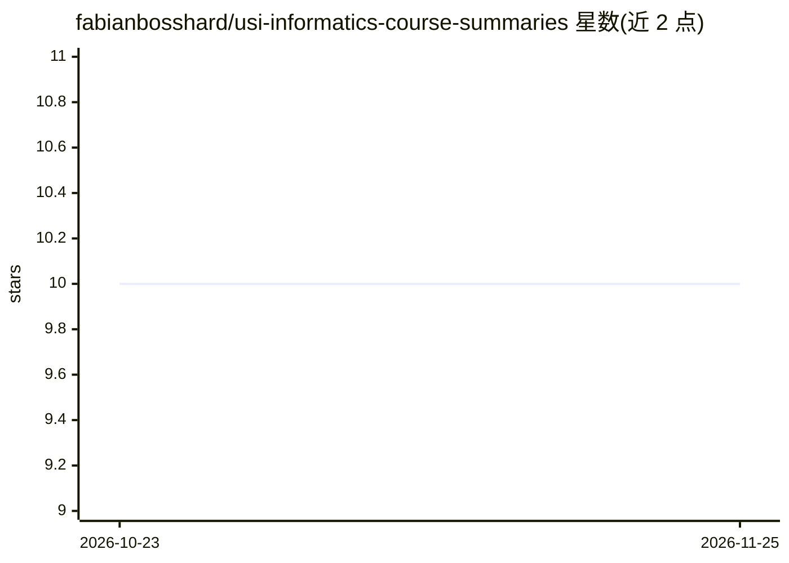

# fabianbosshard/usi-informatics-course-summaries

⭐ 10 · TeX · CC-BY-4.0 · 推送 2026-07-01 · [GitHub](https://github.com/fabianbosshard/usi-informatics-course-summaries) · [官网](https://fabianbosshard.github.io/usi-informatics-course-summaries/) · 个人维护

**USI 信息学本科与硕士课程的学生笔记合集**

非官方的学生课程笔记仓库，收录卢加诺 Università della Svizzera italiana（USI）信息学本科与硕士课程的 TeX 源码笔记，PDF 供在线查看。内容涉及算法与数据结构、人工智能、离散结构、优化方法、数学等主题，仓库声明笔记非官方、不完整、可能含错误，并欢迎通过邮件反馈勘误。

## 筛选速览

| 维度 | 判定 | 备注 |
|---|---|---|
| AI 角色 | `ai-knowledge` | 知识聚合/清单类 |
| 许可风险 | `viral` | CC-BY-4.0 |
| 部署形态 | `None` |  |
| 模型依赖 | — | README 未给出锁定关系 |
| 硬件要求 | — | 无带数字的原话,不猜 |
| 安装摩擦 | `low` | 无编译、无系统依赖或容器化 |
| 成熟度 | — | 结构信号不足 |

## 能力要点

- 收录本科与硕士信息学课程的 TeX 源码笔记
- PDF 在仓库内提供在线查看
- 主题覆盖算法、人工智能、离散结构、优化方法等

## 适用场景

- 查阅 USI 信息学课程的学生视角笔记
- 参考 LaTeX 格式的课程笔记撰写方式

## 场景标签

`教程课程` · 领域:学习与行业

## 证据(README 行号)

> L3: Unofficial student‑written course notes for Bachelor and Master courses in Informatics at the **Università della Svi
> L5: ## 📚 Summaries
> L7: This repository contains only the TeX sources. The PDFs can be viewed here.

## 星数曲线

2026-10-23 10 → 2026-11-25 10（+0）

---
*卡片 v1 · prompt 1.4 · 生成 2026-11-19 · 置信度 high · 依据 README sha `0649e519b84c` · [字段定义](../../DATASET.md)*
