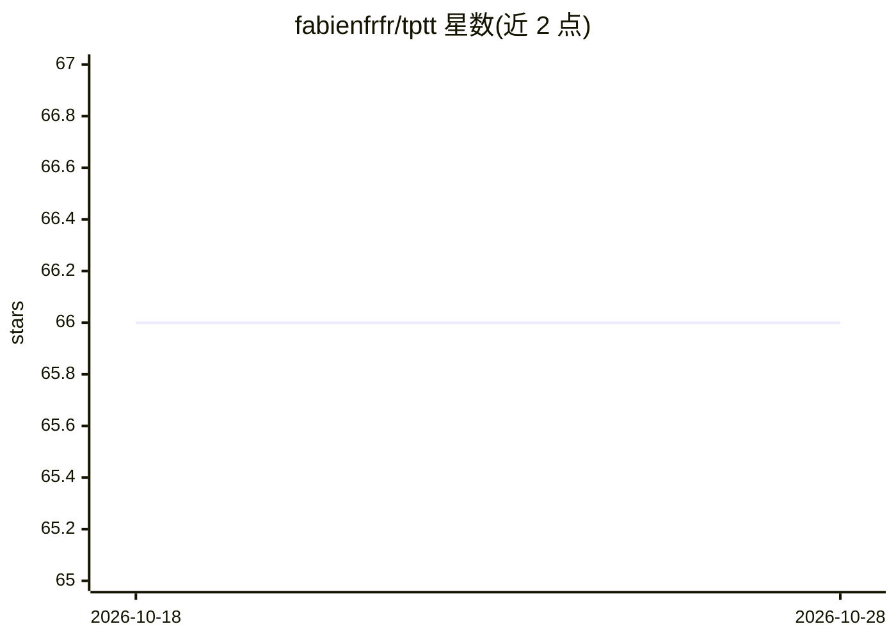

# fabienfrfr/tptt

⭐ 66 · Python · Apache-2.0 · 推送 2026-06-07 · [GitHub](https://github.com/fabienfrfr/tptt) · 个人维护

**将线性化注意力（LiZA）注入预训练 Transformer 的 PyTorch 库**

TPTT 是一个模块化 Python 库，把 Titans 论文中的 Memory as Gate 等线性化注意力机制（LiZA）封装为可注入模块，用于替换或增强预训练 Transformer 的标准注意力层；提供 DeltaNet 与 DeltaProduct 实现，兼容 Hugging Face Transformers 与 PyTorch 模型，注入后只需轻量微调（如 LoRA）即可对齐记忆机制。面向需要为现有 LLM 添加潜在记忆能力的深度学习研究者与开发者，附论文（arXiv:2506.17671）、文档与 Docker 支持。

## 筛选速览

| 维度 | 判定 | 备注 |
|---|---|---|
| AI 角色 | `ai-ecosystem` | LLM/agent 周边工具 |
| 许可风险 | `permissive` | Apache-2.0 |
| 部署形态 | `self-host` | docker 或自建部署 |
| 模型依赖 | — | README 未给出锁定关系 |
| 硬件要求 | — | 无带数字的原话,不猜 |
| 安装摩擦 | `low` | 无编译、无系统依赖或容器化 |
| 成熟度 | — | 结构信号不足 |

## 能力要点

- 将 LiZA/Memory as Gate 线性化注意力注入预训练 Transformer
- 提供 DeltaNet 与 DeltaProduct 实现，支持 chunk 间递归非线性
- 兼容 Hugging Face Transformers，注入后仅需轻量微调对齐
- 附 LoRA 训练与 LightEval 评测指南

## 适用场景

- 给现有预训练 LLM 添加潜在记忆机制
- 用 DeltaNet/DeltaProduct 做线性注意力研究实验
- 在 PyTorch 项目中集成 LinearAttention 模块

## 场景标签

`微调` · 领域:训练与推理

## 证据(README 行号)

> L21: **TPTT** is a modular Python library designed to inject efficient linearized attention (*LiZA*) mechanisms-such as 
> L28: - **Compatibility**: Designed to integrate with Hugging Face Transformers and similar PyTorch models.

## 星数曲线

2026-10-18 66 → 2026-10-28 66（+0）

---
*卡片 v1 · prompt 1.4 · 生成 2026-10-24 · 置信度 high · 依据 README sha `4dcf150c946a` · [字段定义](../../DATASET.md)*
