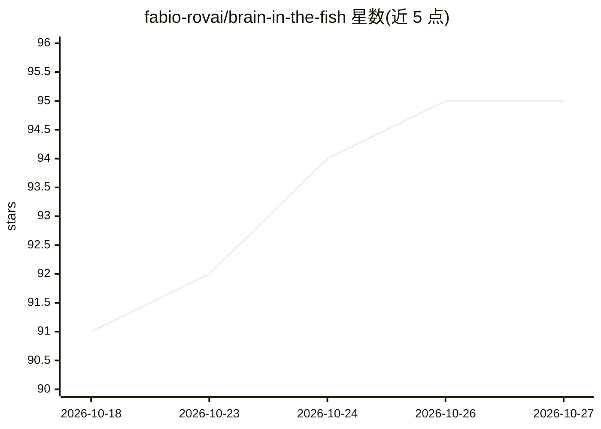

# fabio-rovai/brain-in-the-fish

⭐ 95 · Rust · MIT · 推送 2026-08-11 · [GitHub](https://github.com/fabio-rovai/brain-in-the-fish) · 个人维护

**文档评分与声明核验工具：LLM 评分 + 本体证据校验**

对投标书、论文、政策文件、临床报告等文档进行评分与核验：LLM 将文档分解为 OWL 知识图谱节点（每条声明附原文引用），SPARQL 规则提取结构指标，门控机制比对 LLM 分数与结构证据，输出 CONFIRMED/FLAGGED/REJECTED 三种判定。每个节点的引用会被回查原文，未验证引用会扣减结构分。支持可选的 web 逐条核验，提供验证徽章、CLI 命令与 MCP Server 接入（通过 MCP 由 Claude 充当子代理，本地运行，无需 API key）。面向需要证明评分公正性的评估与审查场景。

## 筛选速览

| 维度 | 判定 | 备注 |
|---|---|---|
| AI 角色 | `ai-ecosystem` | LLM/agent 周边工具 |
| 许可风险 | `permissive` | MIT |
| 部署形态 | `None` |  |
| 模型依赖 | locked-api |  |
| 硬件要求 | — | 无带数字的原话,不猜 |
| 安装摩擦 | `low` | 无编译、无系统依赖或容器化 |
| 成熟度 | — | 结构信号不足 |

## 能力要点

- LLM 分解为 OWL 知识图谱，SPARQL 提取结构指标并派生分类
- 源引用回查原文，未验证引用扣减结构分
- 门控一致性检查输出 CONFIRMED/FLAGGED/REJECTED 判定
- 可选 web 逐条核验与文档验证徽章

## 适用场景

- 核验投标文件中的项目案例、资质与人员声明是否可证实
- 给作文或论述文评分并识别无证据支撑的声明
- 政策文件审查时区分空话与有据提案

## 场景标签

`知识图谱` · 领域:知识与检索

## 证据(README 行号)

> L126: **3. Gate checks consistency** between the LLM's score and the structural evidence:
> L245: No API keys needed. Claude acts as the subagent via MCP — reads the document, builds the ontology, calls the score

## 星数曲线

2026-10-18 91 → 2026-10-27 95（+4）

---
*卡片 v1 · prompt 1.4 · 生成 2026-10-23 · 置信度 high · 依据 README sha `6be67364b084` · [字段定义](../../DATASET.md)*
