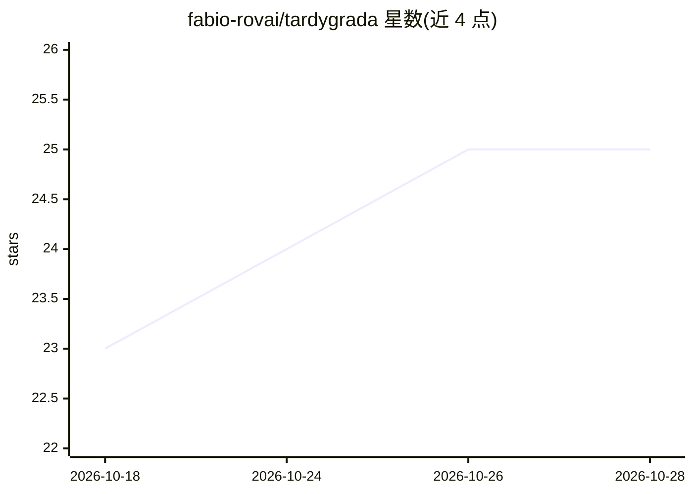

# fabio-rovai/tardygrada

⭐ 25 · C · MIT · 推送 2026-08-11 · [GitHub](https://github.com/fabio-rovai/tardygrada) · 个人维护

**AI agent 声明的验证运行时：8 层确定性流水线门控输出**

纯 C 实现的验证运行时（约 350 KB 二进制、零运行时依赖），在 agent 声明发布前经 8 层验证流水线门控：文本分解为三元组、本体接地、一致性推理、概率聚合、协议合规、形式化证明原语、跨表示校验与偷懒/假工作检测。判定为 VERIFIED/CONFLICT/UNVERIFIABLE 三值，不用 LLM 评审 LLM。附带 .tardy 语言定义可验证 agent 程序，以 MCP 服务器接入 Claude Code、Cursor、Qwen Code。README 明列不适用场景（HaluEval F1 0.03 等）与基准数据（ContraDoc F1 0.57）。

## 筛选速览

| 维度 | 判定 | 备注 |
|---|---|---|
| AI 角色 | `ai-ecosystem` | LLM/agent 周边工具 |
| 许可风险 | `permissive` | MIT |
| 部署形态 | `None` |  |
| 模型依赖 | — | README 未给出锁定关系 |
| 硬件要求 | — | 无带数字的原话,不猜 |
| 安装摩擦 | `low` | 无编译、无系统依赖或容器化 |
| 成熟度 | `idea` | |

## 能力要点

- 8 层确定性验证流水线，三值判定并指明判定层与证据
- MCP 桥接 Claude Code / Cursor / Qwen Code，暴露 verify_claim 等五个工具
- .tardy 语言声明 agent 程序，编译后作为 MCP 服务器运行
- OS 级防篡改：mprotect + SHA-256，@sovereign 级含 ed25519 签名与 BFT 共识

## 适用场景

- 对 agent 文档做矛盾检测（verify-doc）
- 检测偷懒/伪造工作痕迹的 agent 轨迹
- 通过 MCP 让 Claude Code 等客户端提交声明并获取验证判定

## 场景标签

`模型评测` · 领域:评测与运维

## 证据(README 行号)

> L24:  Plugs into Claude Code, Cursor, or Qwen Code as an MCP server.
> L74: **Plug into Claude Code** (MCP):
> L117: fill in. Any MCP client (Claude Code, Cursor, a script) can submit claims to

## 星数曲线

2026-10-18 23 → 2026-10-28 25（+2）

---
*卡片 v1 · prompt 1.4 · 生成 2026-10-27 · 置信度 high · 依据 README sha `4ca29da31d8e` · [字段定义](../../DATASET.md)*
