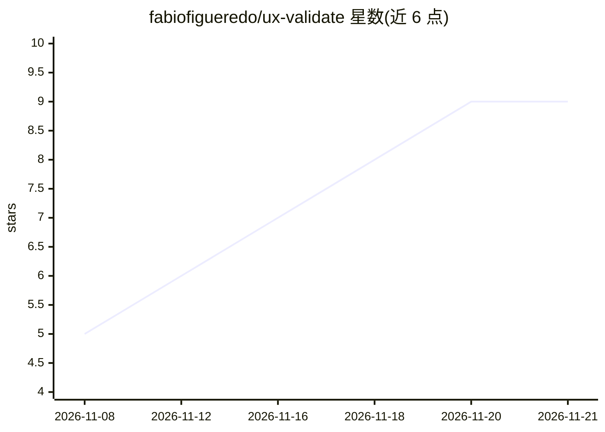

# fabiofigueredo/ux-validate

⭐ 9 · JavaScript · MIT · 推送 2026-11-18 · [GitHub](https://github.com/fabiofigueredo/ux-validate) · [官网](https://fabiofigueredo.github.io/ux-validate/)

**让 AI agent 以 persona 身份测试网页 UX 与可访问性的工具**

ux-validate 对 web 应用（AI 生成或非 AI 生成）做内容、导航、界面与可访问性两层测试：一层是无需语言模型的终端自动化检查（axe-core、WAI-ARIA、键盘、色盲、死链、控制台错误、移动端布局、拼写与占位文本）；另一层 persona 与任务测试在用户已有的 AI 工具（Claude Code、Cursor、Codex CLI、Gemini CLI）内运行，agent 用该工具的模型和账号打开浏览器，按 persona 的设备与限制尝试任务，记录卡点并指出要修改的文件。输出 report.html/report.md，含按 persona 评分与修复建议。提供 GitHub Action 在 CI 跑自动化检查。

## 筛选速览

| 维度 | 判定 | 备注 |
|---|---|---|
| AI 角色 | `ai-enhanced` | 去掉 AI 部分产品仍成立 |
| 许可风险 | `permissive` | MIT |
| 部署形态 | `library` | 以包/库形式分发 |
| 模型依赖 | — | README 未给出锁定关系 |
| 硬件要求 | — | 无带数字的原话,不猜 |
| 安装摩擦 | `low` | 无编译、无系统依赖或容器化 |
| 成熟度 | — | 结构信号不足 |

## 能力要点

- 两层测试：无 AI 的确定性自动化检查 + 需要 AI 工具的 persona 任务测试
-  persona 模拟具体用户的设备与限制（如 68 岁、手机端）并记录卡点与修复文件
- 支持 Claude Code / Cursor / Codex CLI / Gemini CLI 四种工具的命令与 MCP 安装
- 输出 report.html / report.md，含按 persona 评分、证据与修复方案

## 适用场景

- 发布前以不同 persona 检查用户能否完成核心任务
- 测试 Web 应用的 WCAG/WAI-ARIA 可访问性障碍
- 在 CI 中对每个 PR 运行自动化可访问性与死链检查
- 对已发布的站点仅凭 URL 做审计

## 场景标签

`浏览器自动化` · 领域:效率与自动化

## 证据(README 行号)

> L5: Persona-based testing of the **content**, **navigation**, **interface** and **accessibility** of web apps, whether A
> L24: - **Automated checks** run in the terminal, with no language model, and always give the same result: accessibility 
> L28: > **Important: the persona and task test requires AI.** It only runs inside an AI tool with an agent (Claude Code, 

## 星数曲线

2026-11-08 5 → 2026-11-21 9（+4）

---
*卡片 v1 · prompt 1.4 · 生成 2026-11-20 · 置信度 high · 依据 README sha `72ad74e9657f` · [字段定义](../../DATASET.md)*
