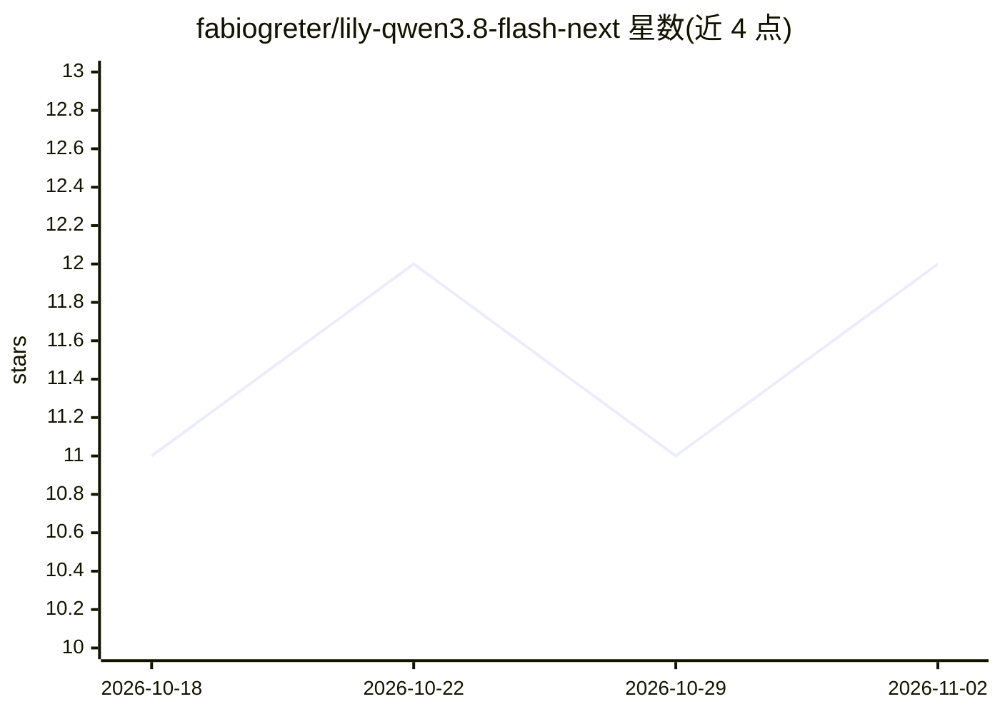

# fabiogreter/lily-qwen3.8-flash-next

⭐ 12 · Rust · Apache-2.0 · 推送 2026-10-26 · [GitHub](https://github.com/fabiogreter/lily-qwen3.8-flash-next) · 个人维护

**Apple Silicon 上单模型 Metal 推理服务器：运行 Qwen3.8-Flash-Next**

Perplexity lily 引擎的 fork，用 Rust 与手写 Metal 内核在 Apple Silicon（M5 及以上）上服务 Qwen3.8-Flash-Next 单一模型，提供 OpenAI 兼容 API（/v1/chat/completions，含 tools 与 reasoning_content）。机制包括：模型自带 draft head 的投机解码、三级会话缓存（GPU 常驻/磁盘/持久前缀，跨重启）、小内存机器的专家缓存（64GB 可运行）。提供 q4 与 q4-xl 两种 4-bit 检查点及从 BF16 权重的转换脚本。限制：需 macOS 26、128GB 统一内存（或 64GB 走专家缓存），非 logit 级一致实现。

## 筛选速览

| 维度 | 判定 | 备注 |
|---|---|---|
| AI 角色 | `ai-ecosystem` | LLM/agent 周边工具 |
| 许可风险 | `permissive` | Apache-2.0 |
| 部署形态 | `library` | 以包/库形式分发 |
| 模型依赖 | — | README 未给出锁定关系 |
| 硬件要求 | — | 无带数字的原话,不猜 |
| 安装摩擦 | `low` | 无编译、无系统依赖或容器化 |
| 成熟度 | — | 结构信号不足 |

## 能力要点

- 手写 Metal 内核与 Metal 4 传输：单步单命令缓冲，主机离开关键路径
- 模型自带 draft head 的投机解码，采样时精确
- 三级会话缓存（GPU 常驻会话/磁盘/持久前缀），跨请求与重启复用
- 64GB 小内存模式：常用专家驻留 GPU，其余从磁盘流式加载

## 适用场景

- 在 Mac 上本地跑 Qwen3.8-Flash-Next 并以 OpenAI 兼容 API 接入 opencode 等客户端
- 长上下文 agent 会话中复用缓存降低每轮开销
- 内存有限的 Apple Silicon 机器上运行完整 4-bit 检查点

## 场景标签

`推理引擎` · 领域:训练与推理

## 证据(README 行号)

> L3: lily-qwen3.8-flash-next is a Metal inference server for Apple Silicon that
> L47: The API is OpenAI-compatible (`/v1/chat/completions`, `/v1/completions`,

## 星数曲线

2026-10-18 11 → 2026-11-02 12（+1）

---
*卡片 v1 · prompt 1.4 · 生成 2026-11-02 · 置信度 mid · 依据 README sha `d797862e7fb7` · [字段定义](../../DATASET.md)*
