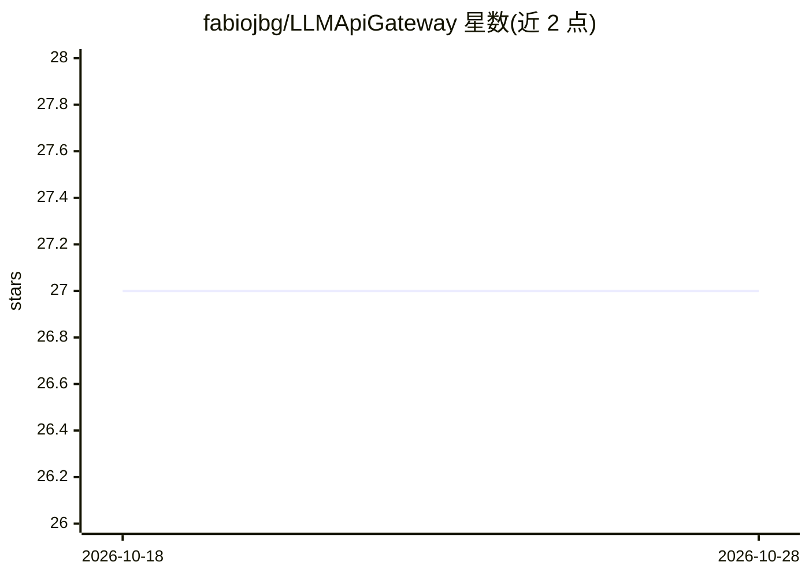

# fabiojbg/LLMApiGateway

⭐ 27 · Python · MIT · 推送 2026-09-02 · [GitHub](https://github.com/fabiojbg/LLMApiGateway) · 个人维护

**个人自托管的容错 LLM 网关：统一接入多家 OpenAI 兼容提供商**

本地运行的 OpenAI 兼容 LLM API 网关，面向使用多家 LLM 提供商的开发者。核心机制：按模型配置回退序列（主模型失败自动切换下一个）、模型轮转（跨提供商分摊负载与费用）、超时/限流重试、自定义 body 参数与请求头注入（可覆盖调用方参数）、OpenRouter 提供商排序。提供 /v1/chat/completions 端点、浏览器规则编辑器（原子写入校验）与用量统计页；文档给出与 Cline、RooCode、OpenCode、GitHub Copilot 等编码代理的集成方式。限制：用量统计在非 OpenRouter 提供商下可能为空值。

## 筛选速览

| 维度 | 判定 | 备注 |
|---|---|---|
| AI 角色 | `ai-ecosystem` | LLM/agent 周边工具 |
| 许可风险 | `permissive` | MIT |
| 部署形态 | `library` | 以包/库形式分发 |
| 模型依赖 | locked-api |  |
| 硬件要求 | — | 无带数字的原话,不猜 |
| 安装摩擦 | `low` | 无编译、无系统依赖或容器化 |
| 成熟度 | — | 结构信号不足 |

## 能力要点

- 模型失败自动回退与序列轮转（按 API key+模型组合在 SQLite 中原子跟踪）
- 自定义 body 参数/请求头注入与覆盖（如 reasoning_effort、service_tier）
- SSE 流式响应增量解析与有界预取校验
- 浏览器配置界面：规则编辑器与用量统计页

## 适用场景

- 为 Cline/RooCode/OpenCode 等编码代理提供带容错的统一模型入口
- 跨多家提供商分摊调用负载与费用、规避单家限流
- 按模型注入自定义参数以控制成本

## 场景标签

`模型网关` · 领域:Agent 开发

## 证据(README 行号)

> L13: This project is a personal LLM Gateway that allows developers to use LLMs from different LLM providers with feature
> L51: - `/v1/chat/completions` - All the magic happens here. This is an OpenAI-compatible chat completions API that can b

## 星数曲线

2026-10-18 27 → 2026-10-28 27（+0）

---
*卡片 v1 · prompt 1.4 · 生成 2026-10-26 · 置信度 high · 依据 README sha `74c5f9a81998` · [字段定义](../../DATASET.md)*
