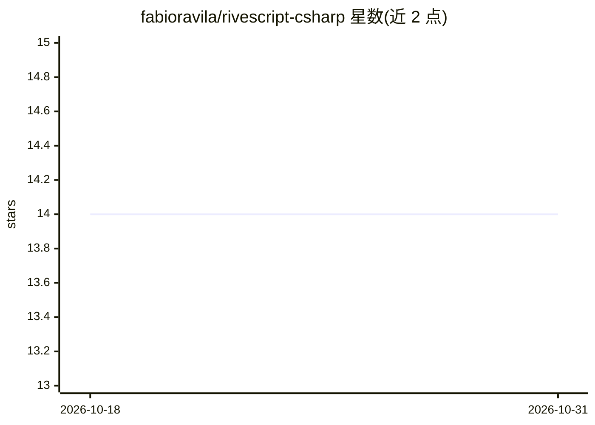

# fabioravila/rivescript-csharp

⭐ 14 · C# · MIT · 推送 2026-03-03 · [GitHub](https://github.com/fabioravila/rivescript-csharp) · 个人维护

**面向 C#/.NET 开发者的 RiveScript 聊天机器人脚本解释器**

基于官方 rivescript-java 代码移植的 C# 实现，按 RiveScript Working Draft 规范解释执行聊天机器人脚本语言。作者因 AIML + Program# 方案的中断或实现复杂度而转向 RiveScript，又因官网宣布的 C# 解释器不可用，遂自行移植。方法名保持与 Java 库一致（pascalCasing），不使用 Linq 以兼容旧框架版本。任务清单显示移植与基本测试已完成，完整 rsts 测试与文档为待办项。

## 筛选速览

| 维度 | 判定 | 备注 |
|---|---|---|
| AI 角色 | `ai-ecosystem` | LLM/agent 周边工具 |
| 许可风险 | `permissive` | MIT |
| 部署形态 | `None` |  |
| 模型依赖 | — | README 未给出锁定关系 |
| 硬件要求 | — | 无带数字的原话,不猜 |
| 安装摩擦 | `low` | 无编译、无系统依赖或容器化 |
| 成熟度 | — | 结构信号不足 |

## 能力要点

- 按 RiveScript Working Draft 规范解释执行聊天机器人脚本
- 基于官方 rivescript-java 移植，方法命名与 Java 库保持一致
- 不使用 Linq，兼容较旧的 .NET 框架版本
- 附 RSBot 演示脚本与基于官方演示的基本测试

## 适用场景

- 在 C#/.NET 应用中嵌入 RiveScript 规则式聊天机器人
- 将 rivescript-java 项目迁移到 .NET 技术栈
- 学习 RiveScript 语言在 C# 下的解释执行机制

## 场景标签

 · 领域:聊天机器人/开发库

## 证据(README 行号)

> L8: This is a C# implementation of a RiveScript interpreter, per the Working Draft
> L9: at http://www.rivescript.com/wd/RiveScript.html
> L11: This code was initially developed based on the official version of the Java interpreter

## 星数曲线

2026-10-18 14 → 2026-10-31 14（+0）

---
*卡片 v1 · prompt 1.4 · 生成 2026-10-31 · 置信度 high · 依据 README sha `5e8f513f9769` · [字段定义](../../DATASET.md)*
