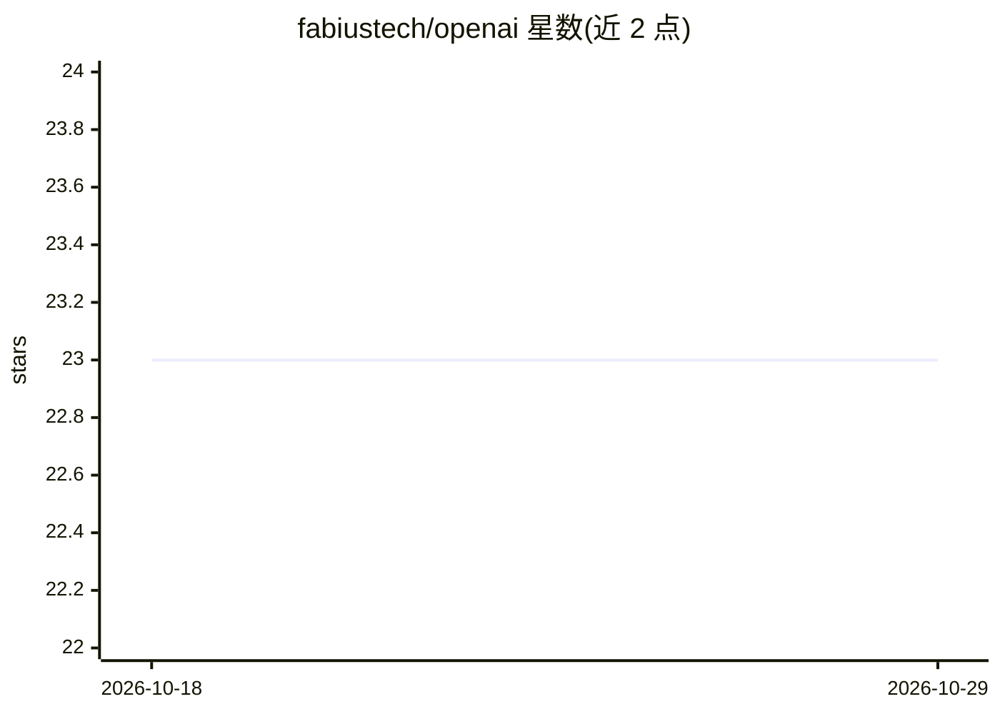

# fabiustech/openai

⭐ 23 · Go · Apache-2.0 · 推送 2026-07-30 · [GitHub](https://github.com/fabiustech/openai) · 组织维护

**非官方零依赖 Go 语言 OpenAI API 客户端库**

用 Go 编写的 OpenAI API 端点非官方客户端库，零第三方依赖，定位是对原有库的重构版本。重构目标包括更符合 Go 惯用风格、改进文档、将 Go 默认值与 OpenAI 默认值不一致的请求参数改为指针类型、统一代码风格以及实现全部端点。面向需要在自己的 Go 程序中调用 OpenAI API 的开发者，通过 go get 安装使用。README 未列出版本兼容性或端点支持细节。

## 筛选速览

| 维度 | 判定 | 备注 |
|---|---|---|
| AI 角色 | `ai-ecosystem` | LLM/agent 周边工具 |
| 许可风险 | `permissive` | Apache-2.0 |
| 部署形态 | `None` |  |
| 模型依赖 | — | README 未给出锁定关系 |
| 硬件要求 | — | 无带数字的原话,不猜 |
| 安装摩擦 | `low` | 无编译、无系统依赖或容器化 |
| 成熟度 | — | 结构信号不足 |

## 能力要点

- 零第三方依赖的 OpenAI API Go 客户端
- 将与 OpenAI 默认值冲突的参数改为指针类型
- 目标是实现全部 OpenAI 端点

## 适用场景

- 在 Go 项目中调用 OpenAI API
- 需要惯用 Go 风格的 OpenAI SDK 替代实现

## 场景标签

 · 领域:LLM API 客户端/开发库

## 证据(README 行号)

> L5: Zero dependency (Unofficial) Go Client for OpenAI API endpoints. Built upon the great work done here.
> L21: ### Installation

## 星数曲线

2026-10-18 23 → 2026-10-29 23（+0）

---
*卡片 v1 · prompt 1.4 · 生成 2026-10-27 · 置信度 high · 依据 README sha `1012311a851d` · [字段定义](../../DATASET.md)*
