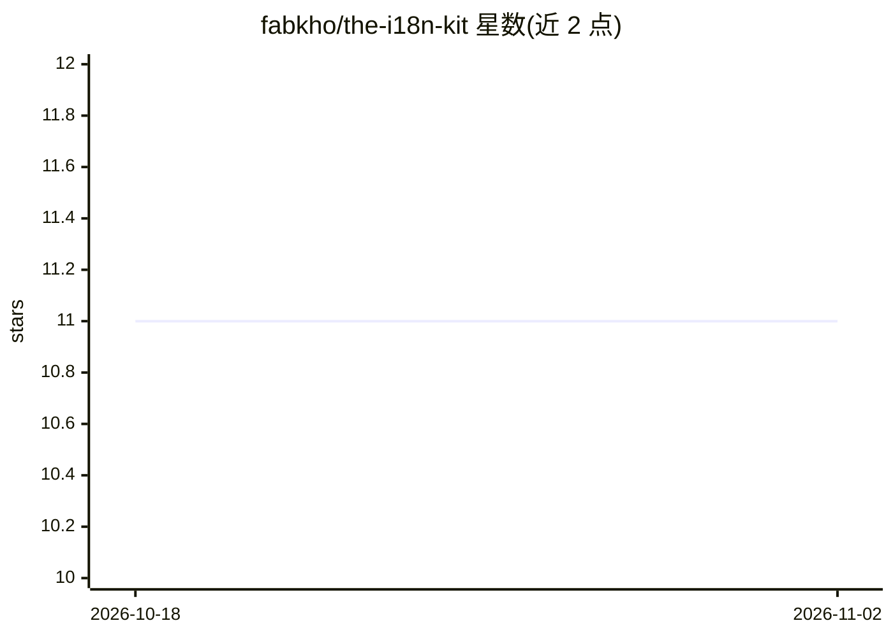

# fabkho/the-i18n-kit

⭐ 11 · TypeScript · MIT · 推送 2026-09-25 · [GitHub](https://github.com/fabkho/the-i18n-kit) · 个人维护

**面向 AI agent 与大型 monorepo 的 i18n 管理工具包**

跨框架的国际化管理工具集：查找缺失翻译键、清理死键、跨全部 locale 与层级批量重命名。以三个 npm 包提供——CLI（其他表面的基础库）、面向 AI 编码 agent 的 MCP server、以及发布 Nuxt 已解析层级图的 Nuxt 包；仓库同时附带 GitHub Action 与 GitLab CI 模板，可从 agent、终端或流水线调用。支持 Nuxt、Laravel、Vue、React/Next 及通用框架，文档参考由源码生成。

## 筛选速览

| 维度 | 判定 | 备注 |
|---|---|---|
| AI 角色 | `ai-ecosystem` | LLM/agent 周边工具 |
| 许可风险 | `permissive` | MIT |
| 部署形态 | `library` | 以包/库形式分发 |
| 模型依赖 | — | README 未给出锁定关系 |
| 硬件要求 | — | 无带数字的原话,不猜 |
| 安装摩擦 | `low` | 无编译、无系统依赖或容器化 |
| 成熟度 | — | 结构信号不足 |

## 能力要点

- 查找缺失键、移除死键、跨 locale 与层级批量重命名
- 提供 CLI 库、MCP server、Nuxt 包三个组件
- 附带 GitHub Action 与 GitLab CI 模板接入流水线
- 支持 Nuxt/Laravel/Vue/React-Next/通用框架

## 适用场景

- 在大型 monorepo 中审计各 locale 翻译覆盖与缺失
- 让 AI 编码 agent 通过 MCP 直接执行 i18n 维护操作
- 在 CI 流水线中自动检查翻译状态

## 场景标签

 · 领域:软件开发/国际化工具

## 证据(README 行号)

> L7: **The i18n toolkit for AI agents and large monorepos.** Find missing keys, remove
> L18: |**@the-i18n-kit/mcp**|npm|MCP server, for AI coding agents|

## 星数曲线

2026-10-18 11 → 2026-11-02 11（+0）

---
*卡片 v1 · prompt 1.4 · 生成 2026-11-02 · 置信度 high · 依据 README sha `ae3a7176d42e` · [字段定义](../../DATASET.md)*
