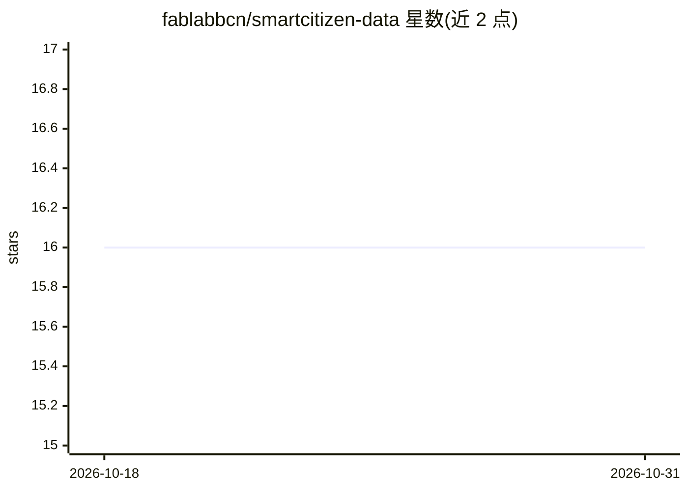

# fablabbcn/smartcitizen-data

⭐ 16 · Python · GPL-3.0 · 推送 2026-10-29 · [GitHub](https://github.com/fablabbcn/smartcitizen-data) · [官网](https://docs.smartcitizen.me/data/data-tools/) · 组织维护

**Smart Citizen 环境传感器数据分析框架**

Python 数据分析框架，面向低成本环境传感器数据：与多个传感器 API 交互，读取设备数据，支持清洗、指标计算、导出（CSV/Parquet）、数据建模与传感器校准，并生成可视化图表与 HTML/PDF 分析报告，可上传 Zenodo。通过硬件 blueprint 机制选择处理流程，配置存于 ~/.config/scdata。以 pip 包 scdata 提供，绘图与存储为可选 extra，兼容 Python 3.10–3.13，可在 Binder 试用。

## 筛选速览

| 维度 | 判定 | 备注 |
|---|---|---|
| AI 角色 | `ai-enhanced` | 去掉 AI 部分产品仍成立 |
| 许可风险 | `viral` | GPL-3.0 |
| 部署形态 | `library` | 以包/库形式分发 |
| 模型依赖 | — | README 未给出锁定关系 |
| 硬件要求 | — | 无带数字的原话,不猜 |
| 安装摩擦 | `low` | 无编译、无系统依赖或容器化 |
| 成熟度 | — | 结构信号不足 |

## 能力要点

- 与多个传感器 API 交互并按 blueprint 加载与处理设备数据
- 数据清洗、指标计算与导出（含 Parquet/S3 存储扩展）
- 传感器数据建模与校准
- 生成 HTML/PDF 分析报告并可上传 Zenodo

## 适用场景

- 下载并清洗 Smart Citizen 设备的空气质量和环境传感数据
- 对低成本传感器做建模校准
- 生成环境监测数据分析报告并归档到 Zenodo

## 场景标签

`数据分析` · 领域:效率与自动化

## 证据(README 行号)

> L8: Welcome to **SmartCitizen Data**. This is a data analysis framework for working with sensor data in different ways:
> L12: - Model sensor data and calibrate sensors

## 星数曲线

2026-10-18 16 → 2026-10-31 16（+0）

---
*卡片 v1 · prompt 1.4 · 生成 2026-10-30 · 置信度 mid · 依据 README sha `173b8a32503a` · [字段定义](../../DATASET.md)*
