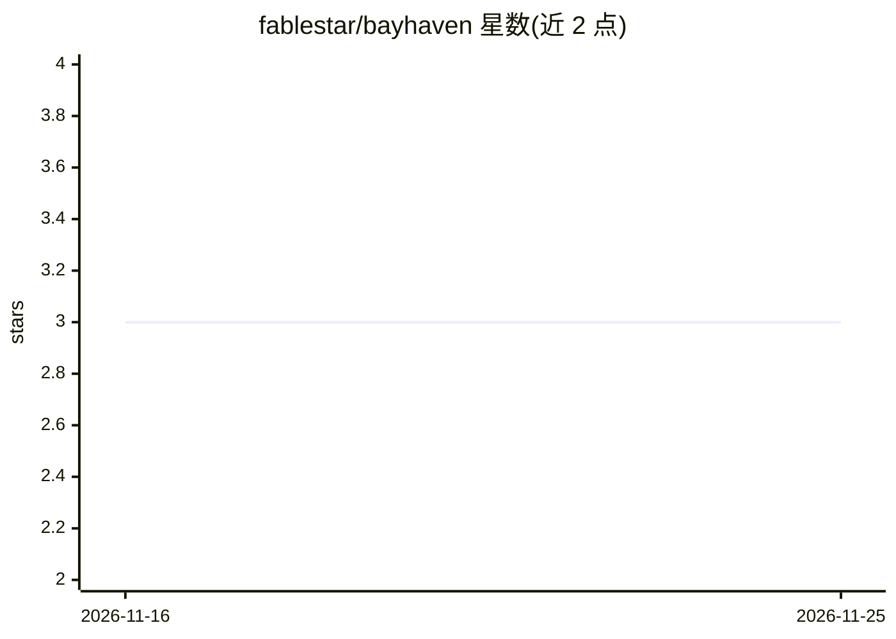

# fablestar/bayhaven

⭐ 3 · JavaScript · MIT · 推送 2026-11-12 · [GitHub](https://github.com/fablestar/bayhaven) · [官网](https://fablestar.games/watch.html) · 组织维护

**AI 编程模型逐行编写的开源开放世界浏览器游戏**

一个开放世界犯罪题材游戏，全部代码由编程模型 Claude Fable 5.2 在直播会话中逐行编写并提交。游戏基于 three.js 与普通 ES 模块构建，在浏览器中运行；仓库同时包含模型每轮会话读取的计划文件、模块契约文档与会话必过的自动化检查套件。人类可自行领 issue 贡献，或按 CONTRIBUTING.md 中提供的提示词让编程 agent 生成 PR，通过检查且符合计划的 PR 会被合并。MIT 许可，本地运行需 npm。

## 筛选速览

| 维度 | 判定 | 备注 |
|---|---|---|
| AI 角色 | `ai-enhanced` | 去掉 AI 部分产品仍成立 |
| 许可风险 | `permissive` | MIT |
| 部署形态 | `None` |  |
| 模型依赖 | — | README 未给出锁定关系 |
| 硬件要求 | — | 无带数字的原话,不猜 |
| 安装摩擦 | `low` | 无编译、无系统依赖或容器化 |
| 成熟度 | — | 结构信号不足 |

## 能力要点

- 代码由 Claude Fable 5.2 在直播会话中逐行编写并提交
- three.js 浏览器游戏，npm ci + npm run dev 本地运行
- headless Chromium 检查套件，每次 PR 与会话均运行
- CONTRIBUTING.md 提供可粘贴的 agent 提示词供贡献者使用

## 适用场景

- 在浏览器中直接游玩开放世界犯罪游戏
- 观摩 AI 编程模型逐会话构建完整游戏的直播过程
- 自己或让自己的编程 agent 按契约文档贡献代码

## 场景标签

 · 领域:游戏

## 证据(README 行号)

> L5: An original open-world crime game, written live by **Claude Fable 5.2**. Fable writes every line of code here and ma
> L15: |`src/`|The game: three.js, plain modules, one registry|
> L32: Pick an open issue, build it, open a pull request. You can do it by hand or point your own coding agent at CONTRIBU

## 星数曲线

2026-11-16 3 → 2026-11-25 3（+0）

---
*卡片 v1 · prompt 1.4 · 生成 2026-11-22 · 置信度 high · 依据 README sha `9c91d4727a00` · [字段定义](../../DATASET.md)*
