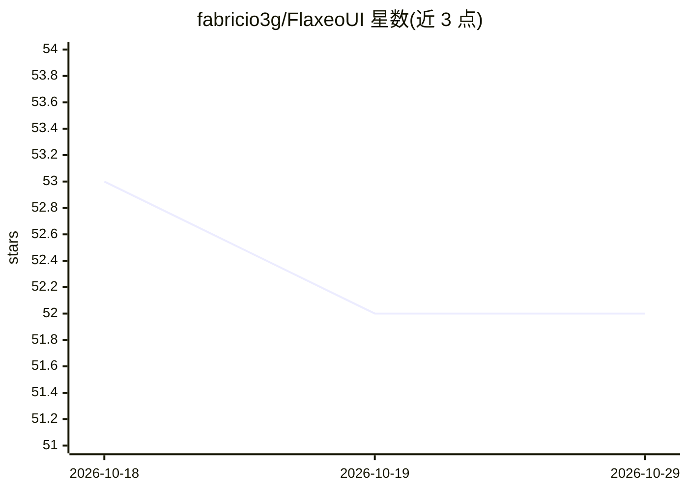

# fabricio3g/FlaxeoUI

⭐ 52 · TypeScript · MIT · 推送 2026-10-25 · [GitHub](https://github.com/fabricio3g/FlaxeoUI) · 个人维护

**给本地用户的 stable-diffusion.cpp 桌面图像生成工作台**

基于 Electron + Vue 3 的桌面应用，为 stable-diffusion.cpp（sd-cli / sd-server 双后端）提供图形界面：支持文生图、编辑（inpaint、img2img、多参考 Kontext 与 Qwen Edit）、视频生成，附带作业队列、配方模板、图库与模型中心（SDXL/FLUX/Wan 等）。可从 UI 下载后端二进制、量化转换 GGUF 模型，提供低显存档与 VAE tiling 等硬件辅助选项。主要在 Windows 开发，CI 产出 Linux AppImage/deb；另可仅运行 API 服务器（无 Electron）。

## 筛选速览

| 维度 | 判定 | 备注 |
|---|---|---|
| AI 角色 | `ai-native` | 本体是模型或模型工具 |
| 许可风险 | `permissive` | MIT |
| 部署形态 | `library` | 以包/库形式分发 |
| 模型依赖 | — | README 未给出锁定关系 |
| 硬件要求 | — | 无带数字的原话,不猜 |
| 安装摩擦 | `low` | 无编译、无系统依赖或容器化 |
| 成熟度 | — | 结构信号不足 |

## 能力要点

- Text2Image / Edit（inpaint、多参考、Qwen Edit）/ Video（T2V、I2V、FLF2V）生成
- sd-cli 与 sd-server 双后端，可从应用内安装后端与模型启动包
- 作业队列：忙碌时继续生成，支持重排、暂停、取消
- UI 内量化/转换模型为 GGUF，含低显存档与 flash attention 等硬件选项

## 适用场景

- 在桌面本地运行 stable-diffusion.cpp 生成与编辑图片
- 用队列和配方模板管理批量生成任务
- 在低显存设备上运行图像生成

## 场景标签

`图像生成` `视频生成` · 领域:内容生成

## 证据(README 行号)

> L7: **Local. Fast. Beautiful.** A desktop studio for **stable-diffusion.cpp**
> L13: - **Text2Image**, **Edit** (inpaint / multi-ref Kontext & Qwen Edit / img2img), **Video** (T2V, I2V, FLF2V)
> L99: - **Inference:** stable-diffusion.cpp

## 星数曲线

2026-10-18 53 → 2026-10-29 52（-1）

---
*卡片 v1 · prompt 1.4 · 生成 2026-10-24 · 置信度 high · 依据 README sha `0810311284bc` · [字段定义](../../DATASET.md)*
