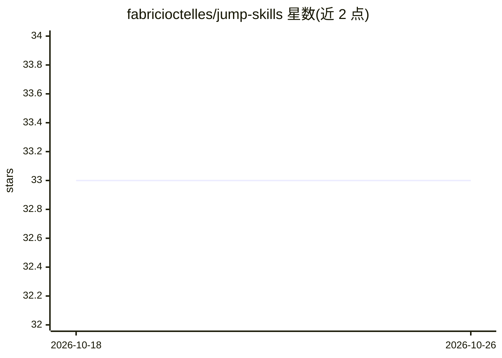

# fabricioctelles/jump-skills

⭐ 33 · Shell · MIT · 推送 2026-10-24 · [GitHub](https://github.com/fabricioctelles/jump-skills) · [官网](https://jumpskills.ninja) · 个人维护

**AI 编码 agent 的元技能集合：按需路由到各云厂商专家技能**

面向 AI 编码 agent（Claude Code、Cursor、Kiro、Codex、Copilot 等）的元技能（Ninja）库：每个 Ninja 是一个编排层，接收任务描述后识别、按需加载并执行对应专家技能。技能聚合自 AWS、Microsoft、Google、Datadog、Firecrawl 等官方仓库（如 AWS 230+、Google Cloud 85+、Datadog 57 条）。安装方式为克隆本仓库后运行 sync-repos.sh 同步外部技能仓库，再由 install-ninjas.sh 自动检测并安装到各 agent 的技能目录；明确声明不能用 npx skills 安装。

## 筛选速览

| 维度 | 判定 | 备注 |
|---|---|---|
| AI 角色 | `ai-knowledge` | 知识聚合/清单类 |
| 许可风险 | `permissive` | MIT |
| 部署形态 | `library` | 以包/库形式分发 |
| 模型依赖 | — | README 未给出锁定关系 |
| 硬件要求 | — | 无带数字的原话,不猜 |
| 安装摩擦 | `high` | 编译与系统依赖俱全 |
| 成熟度 | — | 结构信号不足 |

## 能力要点

- Ninja 元技能按任务描述路由到专家技能并按需加载执行
- 聚合 AWS/Azure/Google Cloud/Google AI/Datadog/Firecrawl 等多个官方技能仓库
- 安装器自动检测 Claude Code、Cursor、Codex、Copilot 等多个 agent 并安装
- Video Ninja 覆盖 92 条技能指令（HyperFrames、ffmpeg、DaVinci Resolve 等）

## 适用场景

- 让我的编码 agent 通过一个入口调用 AWS/Azure/GCP 各领域专家技能
- 为多个 AI 编码 agent 统一安装一批云与 DevOps 技能
- 视频制作工作流中编排抓取、剪辑、字幕等技能

## 场景标签

`精选清单` `Agent 框架` · 领域:Agent 开发

## 证据(README 行号)

> L22: **Ninjas** are intelligent **meta-skills** — master orchestrators that route your requests to the most appropriate 
> L82: |Claude Code|`~/.claude/skills/`|

## 星数曲线

2026-10-18 33 → 2026-10-26 33（+0）

---
*卡片 v1 · prompt 1.4 · 生成 2026-10-25 · 置信度 mid · 依据 README sha `5ffb6bc0647d` · [字段定义](../../DATASET.md)*
