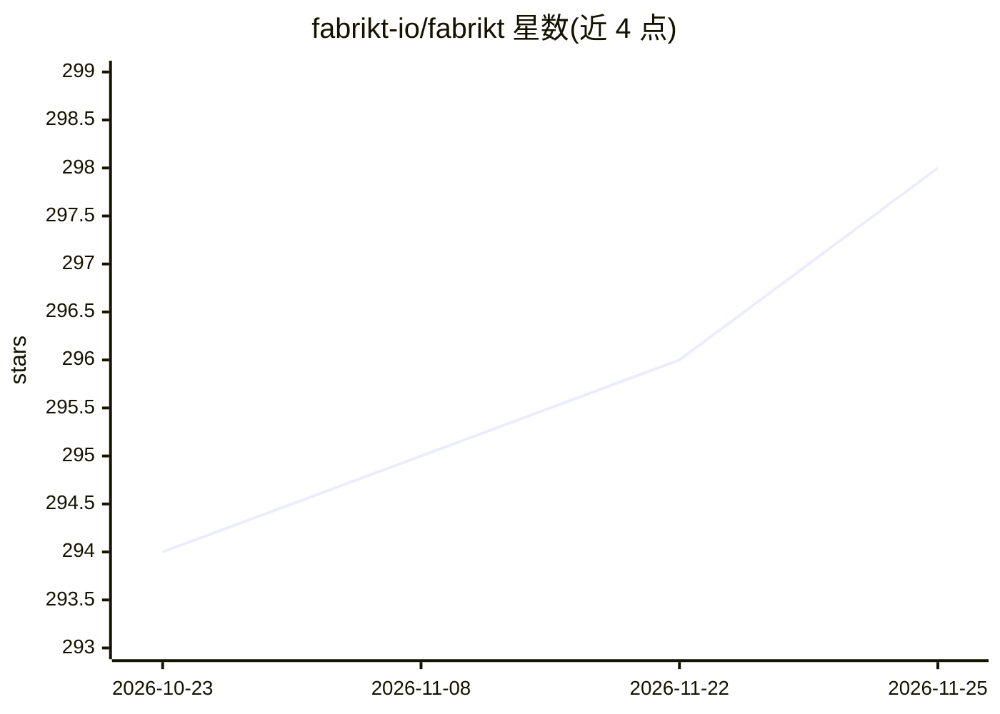

# fabrikt-io/fabrikt

⭐ 298 · Kotlin · Apache-2.0 · 推送 2026-11-22 · [GitHub](https://github.com/fabrikt-io/fabrikt) · [官网](https://try.fabrikt.io) · 组织维护

**从 OpenAPI 3 规范生成 Kotlin 数据类与客户端/控制器代码**

读取 OpenAPI 3 规范（或 draft-04~2020-12 的 JSON Schema 文档）生成 Kotlin 数据类，支持空安全、枚举、密封类、多态等建模特性，并可为 OkHttp、OpenFeign、Ktor、Spring、Micronaut 等框架生成 HTTP 客户端接口与控制器接口。可通过命令行 jar、Gradle 任务/插件、Maven 插件或 Docker 镜像运行，支持作为构建工具的常驻集成使契约与代码保持一致。注意事项：内联 schema 仅部分形态生成专门模型；Spring 控制器跳过 OpenAPI 3.2 query 操作；Kubernetes CRD 转换不受支持。

## 筛选速览

| 维度 | 判定 | 备注 |
|---|---|---|
| AI 角色 | `ai-ecosystem` | LLM/agent 周边工具 |
| 许可风险 | `permissive` | Apache-2.0 |
| 部署形态 | `self-host` | docker 或自建部署 |
| 模型依赖 | — | README 未给出锁定关系 |
| 硬件要求 | — | 无带数字的原话,不猜 |
| 安装摩擦 | `low` | 无编译、无系统依赖或容器化 |
| 成熟度 | — | 结构信号不足 |

## 能力要点

- 从 OpenAPI 3 或 JSON Schema 文档生成带 Jackson/kotlinx.serialization 注解的 Kotlin 数据类
- 生成 OkHttp/OpenFeign/Ktor/Spring HTTP Interface 客户端及 Spring/Micronaut/Ktor 控制器
- 支持 GraalVM Native 反射注册与密封类多态生成
- 提供 CLI jar、Gradle 插件、Maven 插件、Docker 镜像与在线 Playground 多种使用方式

## 适用场景

- 为团队 API 规范自动生成 Kotlin 客户端与服务端接口骨架
- 把代码生成集成进 Gradle/Maven 构建，随 API 演进保持契约与代码一致
- 从 JSON Schema（如 Nakadi EventType 内嵌 schema）生成模型类

## 场景标签

`代码生成` · 领域:编码与开发

## 证据(README 行号)

> L11: This library was built to take advantage of the complex modeling features available in OpenAPI 3. It generates Kotl
> L52:  * **OkHttp Client (w/ Jackson Models)**
> L54:  * **Ktor Client (w/ Jackson & Kotlin Serialization models)**

## 星数曲线

2026-10-23 294 → 2026-11-25 298（+4）

---
*卡片 v1 · prompt 1.4 · 生成 2026-11-25 · 置信度 mid · 依据 README sha `c58ec656ff47` · [字段定义](../../DATASET.md)*
