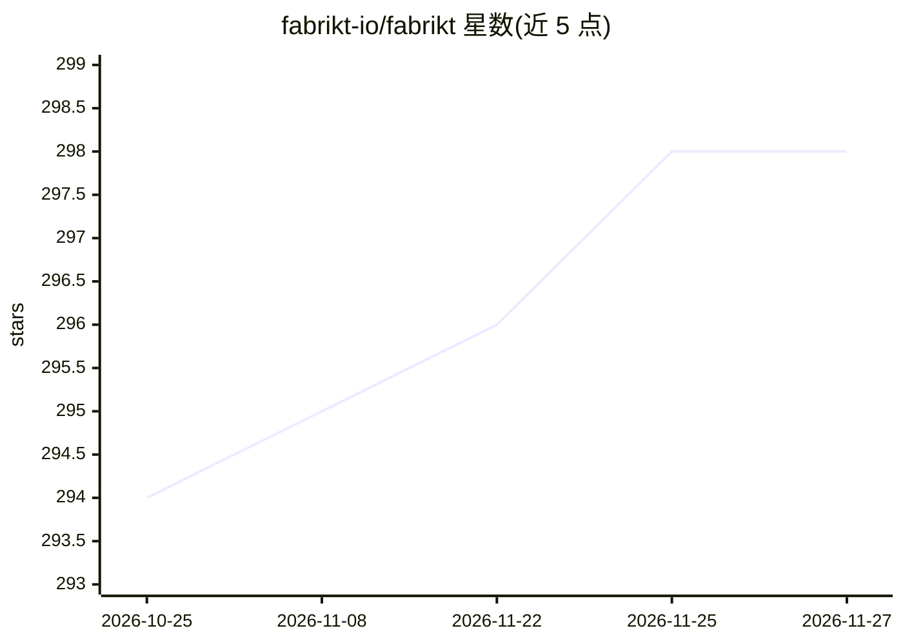

# fabrikt-io/fabrikt

⭐ 298 · Kotlin · Apache-2.0 · 推送 2026-11-26 · [GitHub](https://github.com/fabrikt-io/fabrikt) · [官网](https://try.fabrikt.io) · 组织维护

**从 OpenAPI 3 规范生成 Kotlin 数据类与 HTTP 客户端/控制器的代码生成库**

面向 OpenAPI 3 规范的 Kotlin 代码生成库，生成带 Jackson 或 kotlinx.serialization 注解的数据类，支持可空性、内联 schema、枚举、密封类、多态（@JsonSubTypes）、GraalVM 原生反射注册等特性；并为 OkHttp、OpenFeign、Ktor、Spring HTTP Interface 生成客户端，为 Spring MVC、Micronaut、Ktor 生成控制器接口。还可直接读取 JSON Schema（draft-04 至 2020-12）生成模型。以命令行 jar、Gradle 任务/插件、Maven 插件、Maven Central 依赖及 Docker 镜像形式提供，并可集成进构建工具使契约与代码保持一致。

## 筛选速览

| 维度 | 判定 | 备注 |
|---|---|---|
| AI 角色 | `ai-enhanced` | 去掉 AI 部分产品仍成立 |
| 许可风险 | `permissive` | Apache-2.0 |
| 部署形态 | `self-host` | docker 或自建部署 |
| 模型依赖 | — | README 未给出锁定关系 |
| 硬件要求 | — | 无带数字的原话,不猜 |
| 安装摩擦 | `low` | 无编译、无系统依赖或容器化 |
| 成熟度 | — | 结构信号不足 |

## 能力要点

- 生成 Jackson/kotlinx.serialization 注解的 Kotlin 数据类，支持密封类与多态
- 为 OkHttp/OpenFeign/Ktor/Spring 生成客户端，为 Spring MVC/Micronaut/Ktor 生成控制器
- 支持直接从 JSON Schema（draft-04 至 2020-12）生成模型，无需 OpenAPI 规范
- 提供 CLI、Gradle、Maven、Docker 镜像及在线 Playground 多种使用方式

## 适用场景

- 从 OpenAPI 3 规范生成 Kotlin API 客户端与服务端接口代码
- 把代码生成集成进 Gradle/Maven 构建以保证契约与代码一致
- 从 JSON Schema 或 Nakadi EventType 清单生成 Kotlin 模型

## 场景标签

`代码生成` · 领域:编码与开发

## 证据(README 行号)

> L3: # Fabrikt `/ˈfa-brikt/` - Kotlin code from OpenAPI 3
> L11: This library was built to take advantage of the complex modeling features available in OpenAPI 3. It generates Kotl

## 星数曲线

2026-10-25 294 → 2026-11-27 298（+4）

---
*卡片 v1 · prompt 1.4 · 生成 2026-11-27 · 置信度 high · 依据 README sha `c1014499033b` · [字段定义](../../DATASET.md)*
