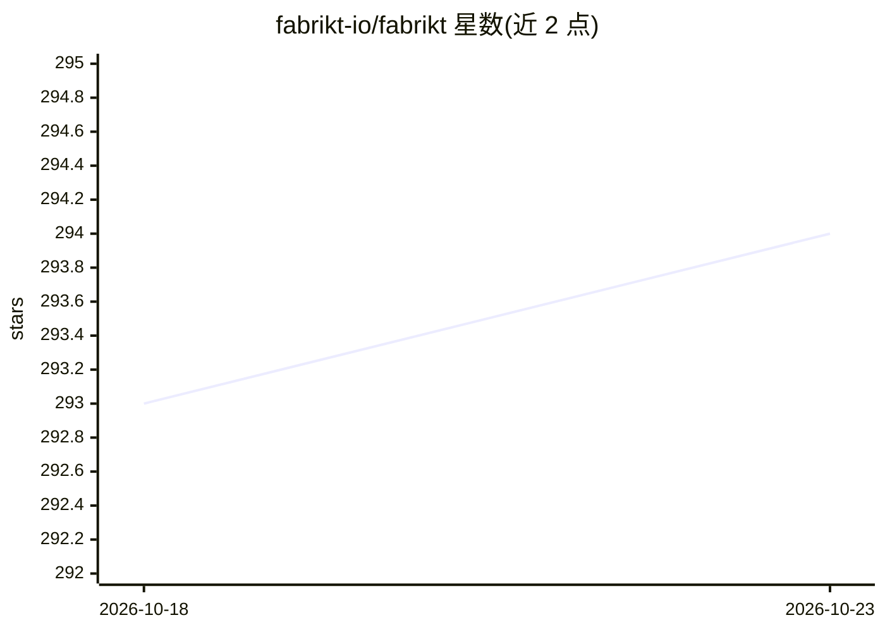

# fabrikt-io/fabrikt

⭐ 294 · Kotlin · Apache-2.0 · 推送 2026-10-22 · [GitHub](https://github.com/fabrikt-io/fabrikt) · [官网](https://try.fabrikt.io) · 组织维护

**从 OpenAPI 3 规范生成 Kotlin 代码的库与 CLI 工具**

读取 OpenAPI 3 规范（本地路径、http/https URL 或带 JSON Pointer 的 JSON Schema 文档，draft-04 至 2020-12），生成带 Jackson 或 kotlinx.serialization 注解的 Kotlin 数据类，以及 OkHttp、OpenFeign、Ktor、Spring HTTP Interface 客户端与 Spring MVC、Micronaut、Ktor 服务端控制器接口。支持空安全、密封类多态、GraalVM 原生反射注册、Json Merge Patch 等特性，并提供 API key/Bearer/OAuth2 客户端鉴权选项。以可执行 jar、Maven 依赖、Gradle/Maven 插件及 Docker 镜像形式提供，面向 Kotlin 服务端开发者持续集成到构建流程。注意：本项目与 AI 无关，主题标签中的 openai-api 指 OpenAPI。

## 筛选速览

| 维度 | 判定 | 备注 |
|---|---|---|
| AI 角色 | `ai-ecosystem` | LLM/agent 周边工具 |
| 许可风险 | `permissive` | Apache-2.0 |
| 部署形态 | `self-host` | docker 或自建部署 |
| 模型依赖 | — | README 未给出锁定关系 |
| 硬件要求 | — | 无带数字的原话,不猜 |
| 安装摩擦 | `low` | 无编译、无系统依赖或容器化 |
| 成熟度 | — | 结构信号不足 |

## 能力要点

- 从 OpenAPI 3 与 JSON Schema（draft-04–2020-12）生成 Kotlin 数据类
- OkHttp/OpenFeign/Ktor/Spring 客户端与 Spring/Micronaut/Ktor 控制器生成
- 可执行 jar、Gradle/Maven 插件、JBang、Docker 镜像多种运行方式
- opt-in API key/Bearer/OAuth2 客户端鉴权辅助

## 适用场景

- 从 API 契约生成 Kotlin 客户端和服务端骨架，保持契约与代码一致
- 在 Gradle/Maven 构建中集成代码生成，随 API 演进自动更新
- CI/CD 环境用 Docker 镜像运行代码生成

## 场景标签

`代码生成` · 领域:编码与开发

## 证据(README 行号)

> L11: This library was built to take advantage of the complex modeling features available in OpenAPI 3. It generates Kotl
> L23: as well as HTTP clients and controllers for a number of popular frameworks (see Features).

## 星数曲线

2026-10-18 293 → 2026-10-23 294（+1）

---
*卡片 v1 · prompt 1.4 · 生成 2026-10-22 · 置信度 low · 依据 README sha `59f009534b69` · [字段定义](../../DATASET.md)*
