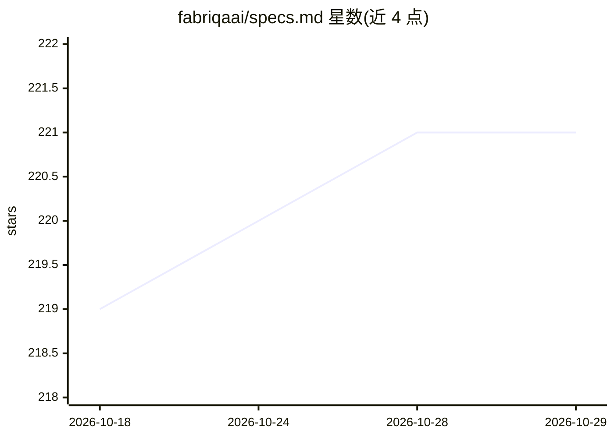

# fabriqaai/specs.md

⭐ 221 · TypeScript · MIT · 推送 2026-09-09 · [GitHub](https://github.com/fabriqaai/specs.md) · [官网](https://specs.md) · 组织维护

**面向 AI 编码工具的规范驱动开发框架，提供四条可选流程**

specs.md 是一个 AI 原生开发框架，通过 npx 安装器为项目设置 agent 定义、斜杠命令与目录结构，在四种流程中选择：Ideation（创意头脑风暴）、Simple（仅生成需求/设计/任务文档）、FIRE（自适应执行、支持存量项目与 monorepo）、AI-DLC（含 DDD 的完整生命周期与追溯）。以可移植的 Markdown 文件形式工作，适配 Claude Code、Cursor、GitHub Copilot、Gemini CLI 等多种 AI 编码工具，另提供 VS Code 侧边栏扩展与本地浏览器/终端 Dashboard。要求 Node.js 18 以上，且需自备一个 AI 编码工具。

## 筛选速览

| 维度 | 判定 | 备注 |
|---|---|---|
| AI 角色 | `ai-ecosystem` | LLM/agent 周边工具 |
| 许可风险 | `permissive` | MIT |
| 部署形态 | `library` | 以包/库形式分发 |
| 模型依赖 | — | README 未给出锁定关系 |
| 硬件要求 | — | 无带数字的原话,不猜 |
| 安装摩擦 | `low` | 无编译、无系统依赖或容器化 |
| 成熟度 | — | 结构信号不足 |

## 能力要点

- 四条流程覆盖从创意到完整 DDD 方法论的开发场景
- 以 Markdown 产物为 AI agent 提供持久化上下文，跨会话加载
- 适配 11 种 AI 编码工具（Claude Code/Cursor/Copilot/Gemini CLI 等）
- 提供 VS Code 侧边栏扩展与本地 Dashboard（Web/CLI）

## 适用场景

- 在 AI 编码助手项目中引入规范驱动流程与结构化产物
- 存量项目或 monorepo 中做自适应执行与标准管理
- 为受监管环境生成全程可追溯的需求/设计/任务文档

## 场景标签

 · 领域:软件开发/LLM 工程流程

## 证据(README 行号)

> L5: **AI-native development framework with pluggable flows for every use case.**
> L78: The installer detects your AI coding tools and sets up agent definitions, slash commands, and project structure for
> L244: Works with Claude Code, Cursor, GitHub Copilot, and other AI coding assistants. Markdown-based agents work anywher

## 星数曲线

2026-10-18 219 → 2026-10-29 221（+2）

---
*卡片 v1 · prompt 1.4 · 生成 2026-10-22 · 置信度 high · 依据 README sha `81c66f0fc31c` · [字段定义](../../DATASET.md)*
