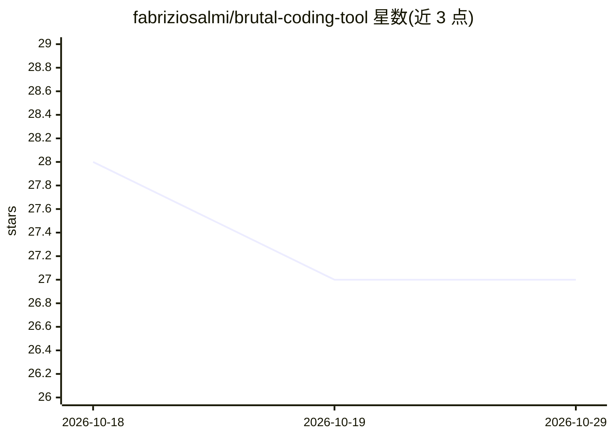

# fabriziosalmi/brutal-coding-tool

⭐ 27 · TypeScript · MIT · 推送 2026-10-17 · [GitHub](https://github.com/fabriziosalmi/brutal-coding-tool) · 个人维护

**浏览器端工具：粘贴 GitHub 仓库 URL，用 Gemini 生成代码质量审计报告**

纯前端（React 19 + Vite）的技术尽调工具：粘贴公开 GitHub 仓库 URL 后，通过 GitHub API 抓取 README、最近 20 次提交、前 300 个文件路径、最多 3 个清单文件与 2 个最大源文件样本，再调用 Google Gemini（优先 gemini-3-pro-preview，回退 gemini-2.5-flash）生成三阶段审计：20 项指标矩阵、'Vibe Check' 文字评估与优先修复清单，可导出 Markdown 或打印 PDF。BYO-key 模式，密钥存于浏览器 localStorage；仅支持公开仓库，采样分析而非全库，LLM 打分非确定性。给开发者做仓库快速体检用。

## 筛选速览

| 维度 | 判定 | 备注 |
|---|---|---|
| AI 角色 | `ai-native` | 本体是模型或模型工具 |
| 许可风险 | `permissive` | MIT |
| 部署形态 | `self-host` | docker 或自建部署 |
| 模型依赖 | — | README 未给出锁定关系 |
| 硬件要求 | — | 无带数字的原话,不猜 |
| 安装摩擦 | `low` | 无编译、无系统依赖或容器化 |
| 成熟度 | `idea` | |

## 能力要点

- 三阶段审计：20 项指标矩阵 + Vibe Check + 优先修复清单
- 纯浏览器运行，无后端，BYO-key（Gemini API key 存 localStorage）
- 自动抓取 GitHub 仓库结构与文件样本作为分析上下文
- 报告可导出 Markdown 与打印为 PDF

## 适用场景

- 对公开 GitHub 仓库快速生成带评分的代码质量审计报告
- 评估 AI 生成代码（vibe code）占比与工程质量
- 获得按优先级排序的修复建议清单

## 场景标签

`代码审查` · 领域:编码与开发

## 证据(README 行号)

> L7: **Brutal Rep Auditor** is a ruthless, AI-powered technical due-diligence tool. Paste a public GitHub repo URL and it
> L59: - **AI**: Google Gemini via `@google/genai` — tries `gemini-3-pro-preview`, falls back to `gemini-2.5-flash`

## 星数曲线

2026-10-18 28 → 2026-10-29 27（-1）

---
*卡片 v1 · prompt 1.4 · 生成 2026-10-26 · 置信度 mid · 依据 README sha `69f4badcadd3` · [字段定义](../../DATASET.md)*
