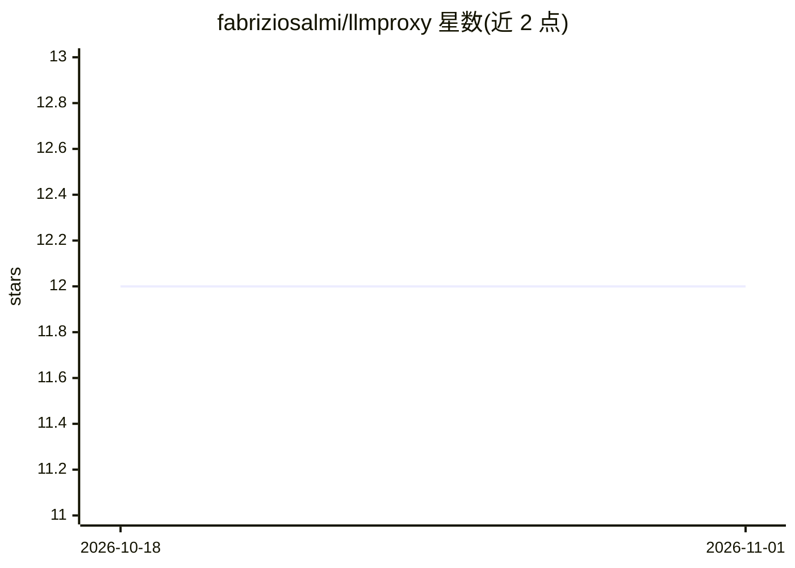

# fabriziosalmi/llmproxy

⭐ 12 · Python · MIT · 推送 2026-10-31 · [GitHub](https://github.com/fabriziosalmi/llmproxy) · [官网](https://fabriziosalmi.github.io/llmproxy/) · 个人维护

**面向小团队/受监管团队的自托管 LLM 安全网关，含可验证审计链**

自托管的单进程 LLM 网关，以 OpenAI 兼容 API 代理多提供商流量：OpenAI、Anthropic、Google、Azure OpenAI、Ollama 有专属适配器，另有 18 个提供商经 OpenAI 兼容适配器接入，支持回退链、熔断与每日预算。安全机制包括哈希链审计日志（可选 HMAC 密封）、字节级防火墙、词法评分防护、PII 掩码、响应净化与工具策略。面向需要自托管并对 LLM 流量留痕问责的小型或受监管团队。限制：仅单实例运行、约 1.2k 请求/s、不含 MCP/agent 网关；词法检测对改写攻击与工具结果内注入的拦截率为 0%。

## 筛选速览

| 维度 | 判定 | 备注 |
|---|---|---|
| AI 角色 | `ai-ecosystem` | LLM/agent 周边工具 |
| 许可风险 | `permissive` | MIT |
| 部署形态 | `self-host` | docker 或自建部署 |
| 模型依赖 | local-ok | 支持本地模型 |
| 硬件要求 | — | 无带数字的原话,不猜 |
| 安装摩擦 | `low` | 无编译、无系统依赖或容器化 |
| 成熟度 | — | 结构信号不足 |

## 能力要点

- 哈希链审计日志记录每个到达管线的请求，可选 HMAC-SHA-256 密封，GDPR 删除留痕不破坏链条
- 字节防火墙（178 签名，解码 URL/Unicode/Base64/hex/ROT13 后匹配）与 30 模式评分防护
- 专属适配器 5 家提供商 + 18 家 OpenAI 兼容适配，回退链、按端点熔断、每日预算限制
- 五环插件体系与 18 个市场插件，Prometheus/Grafana、Slack/Teams/Discord/SIEM webhook 可观测

## 适用场景

- 受监管团队自托管并留存 LLM 流量的可验证审计记录
- 在企业出口统一施加 PII 掩码与提示注入防护
- 多提供商接入与故障回退、预算控制的统一端点

## 场景标签

`模型网关` `网络安全` · 领域:Agent 开发

## 证据(README 行号)

> L3: A self-hosted gateway that sits between your applications and LLM providers and
> L24: - **Provider translation and fallback.** OpenAI, Anthropic, Google, Azure OpenAI and

## 星数曲线

2026-10-18 12 → 2026-11-01 12（+0）

---
*卡片 v1 · prompt 1.4 · 生成 2026-11-01 · 置信度 high · 依据 README sha `eedb79d15339` · [字段定义](../../DATASET.md)*
