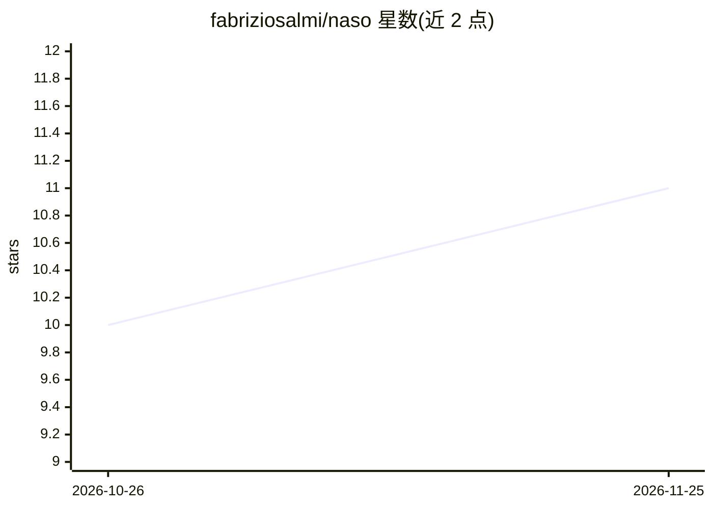

# fabriziosalmi/naso

⭐ 11 · Python · AGPL-3.0 · 推送 2026-11-23 · [GitHub](https://github.com/fabriziosalmi/naso) · [官网](https://fabriziosalmi.github.io/naso/) · 个人维护

**自托管的数据泄露与暗网暴露监控平台，本地 LLM 协助分诊**

NASO 监控泄露语料、Paste 站点、公开 GitHub、Telegram 频道与 onion 服务中组织的暴露信息，将发现关联为身份，并用自运行的本地 LLM 分诊。全部组件（数据库、搜索索引、对象存储、LLM）在自有 Docker Compose 栈内运行。技术栈为 FastAPI + Celery/RabbitMQ 异步摄入、PostgreSQL、Redis、Elasticsearch、MinIO、Tor 集群与 React 前端；提供身份合并聚类、风险评分、VIP 身份 elevated 监控、防篡改审计账本。README 明确仅供授权防御性使用，部署者承担 GDPR 数据控制者责任。

## 筛选速览

| 维度 | 判定 | 备注 |
|---|---|---|
| AI 角色 | `ai-enhanced` | 去掉 AI 部分产品仍成立 |
| 许可风险 | `viral` | AGPL-3.0 |
| 部署形态 | `library` | 以包/库形式分发 |
| 模型依赖 | local-ok | 支持本地模型 |
| 硬件要求 | — | 无带数字的原话,不猜 |
| 安装摩擦 | `low` | 无编译、无系统依赖或容器化 |
| 成熟度 | — | 结构信号不足 |

## 能力要点

- 泄露摄入 API 经 RabbitMQ 解耦，Celery 双 worker 池分别处理逐条与批量任务
- 本地 LLM 分诊，答案按会话历史与租户 ID 缓存于 Redis，SSE 流式返回
- 身份关联引擎跨泄露源合并指标并按广度/深度/时效计算风险评分
- 加固容器基线：非 root uid、cap_drop ALL、只读根文件系统、EdDSA 会话与 JTI 黑名单

## 适用场景

- 监控自己组织的凭据与数据在泄露库和暗网中的暴露情况
- 事件响应中关联多源泄露指标并生成分诊结论
- 在自有基础设施内处理泄露数据以满足合规约束

## 场景标签

`网络安全` · 领域:学习与行业

## 证据(README 行号)

> L4:  Breach and dark-web exposure monitoring, self-hosted
> L5:  Ingest, correlate identities, and triage with a local LLM — on infrastructure you control.
> L13: identities, and triages it with a language model you run yourself. Every
> L141: |`AI_ENDPOINT`|Local LLM endpoint (e.g. `http://host.docker.internal:1234/v1`)|

## 星数曲线

2026-10-26 10 → 2026-11-25 11（+1）

---
*卡片 v1 · prompt 1.4 · 生成 2026-11-19 · 置信度 high · 依据 README sha `0e83845799e2` · [字段定义](../../DATASET.md)*
