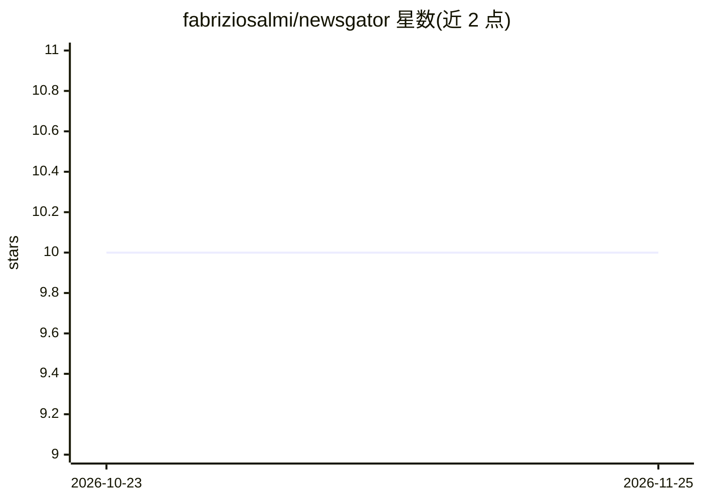

# fabriziosalmi/newsgator

⭐ 10 · Python · MIT · 推送 2026-10-18 · [GitHub](https://github.com/fabriziosalmi/newsgator) · [官网](https://fabriziosalmi.github.io/newsgator/) · 个人维护

**自托管 RSS 聚合器：抓取新闻并用 LLM 翻译改写为意大利语报纸版式**

Python 编写的 RSS 聚合工具：抓取多个新闻源的 RSS 内容，用自然语言处理按相似度分组文章，再调用 LLM 将内容翻译并改写为意大利语新闻体，生成报纸风格 HTML 页面与 RSS 输出，可发布到 GitHub Pages 或由内置 Web 服务器展示。LLM 后端可选 OpenAI API 或本地 LM Studio（默认 phi-4-mini-instruct）；本地模式下数据处理不出本机。限制：目前仅针对意大利语优化，每类默认最多 5 篇文章。

## 筛选速览

| 维度 | 判定 | 备注 |
|---|---|---|
| AI 角色 | `ai-enhanced` | 去掉 AI 部分产品仍成立 |
| 许可风险 | `permissive` | MIT |
| 部署形态 | `self-host` | docker 或自建部署 |
| 模型依赖 | — | README 未给出锁定关系 |
| 硬件要求 | — | 无带数字的原话,不猜 |
| 安装摩擦 | `low` | 无编译、无系统依赖或容器化 |
| 成熟度 | — | 结构信号不足 |

## 能力要点

- 抓取 RSS→相似度聚类→LLM 翻译改写→生成报纸风 HTML 与 RSS 的流水线
- 支持 OpenAI API 与本地 LM Studio（phi-4-mini-instruct）两种 LLM 后端
- Docker 容器内置 Web 服务器，支持一次性生成、仅服务、定时生成等模式
- LM Studio 本地模式下全部处理在本机完成，仅 RSS 抓取出站

## 适用场景

- 把多个 RSS 源聚合改写成一份意大利语电子报并发布到 GitHub Pages
- 本地运行 LM Studio，在不外发文章内容的情况下处理新闻
- 定时生成每日新闻页供家庭或小组订阅

## 场景标签

`AI 写作` `网页抓取` · 领域:效率与自动化

## 证据(README 行号)

> L9: Newsgator is an advanced RSS feed aggregator that collects news from various sources, analyzes content for similarit
> L25: - **🔄 RSS Feed Collection**: Fetches and parses RSS feeds from multiple news sources
> L27: - **🌐 LLM Translation & Rewriting**: Translates content to Italian and rewrites it in a journalistic style

## 星数曲线

2026-10-23 10 → 2026-11-25 10（+0）

---
*卡片 v1 · prompt 1.4 · 生成 2026-11-19 · 置信度 mid · 依据 README sha `087dc6362075` · [字段定义](../../DATASET.md)*
