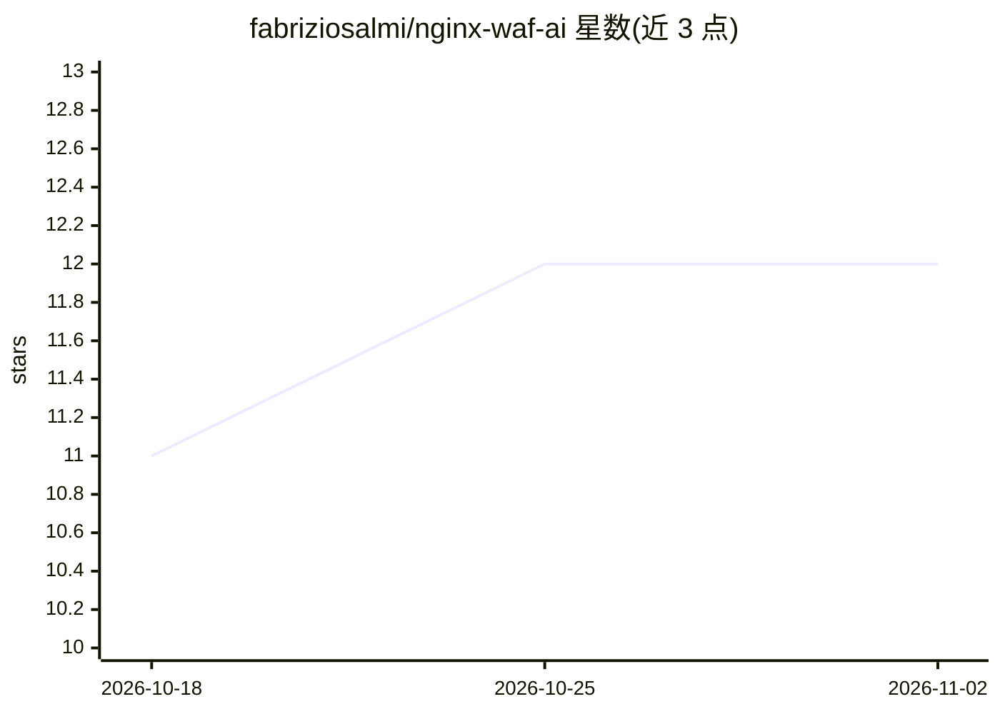

# fabriziosalmi/nginx-waf-ai

⭐ 12 · HTML · MIT · 推送 2026-10-18 · [GitHub](https://github.com/fabriziosalmi/nginx-waf-ai) · 个人维护

**用机器学习检测 HTTP 威胁并自动生成部署 nginx WAF 规则的系统**

面向 nginx 部署的 WAF 规则生成系统：采集节点 HTTP 流量并提取特征，用 scikit-learn 的 Isolation Forest 做异常检测、Random Forest 做已知攻击类型（SQL 注入/XSS/暴力破解）分类，将预测结果转换为 nginx deny/allow 规则，经 SSH 部署到多节点并支持失败回滚。提供 FastAPI REST API（JWT + 角色控制）、Web 控制面板、CLI 与 Prometheus/Grafana 监控栈。README 自述为早期阶段，部分端点未完成，登录端点在源码中被注释，需用默认凭据或 /auth/users 建用户；规则回滚依赖 SSH 访问。

## 筛选速览

| 维度 | 判定 | 备注 |
|---|---|---|
| AI 角色 | `ai-native` | 本体是模型或模型工具 |
| 许可风险 | `permissive` | MIT |
| 部署形态 | `self-host` | docker 或自建部署 |
| 模型依赖 | — | README 未给出锁定关系 |
| 硬件要求 | — | 无带数字的原话,不猜 |
| 安装摩擦 | `low` | 无编译、无系统依赖或容器化 |
| 成熟度 | `idea` | |

## 能力要点

- Isolation Forest 异常检测 + Random Forest 已知攻击分类
- ML 预测转换为 nginx deny/allow 规则，SSH 多节点部署与失败回滚
- FastAPI REST API（JWT + RBAC）、Web 控制面板与 CLI
- Prometheus 指标端点与可选 Grafana/Loki 监控栈（Docker Compose）

## 适用场景

- 自动分析 nginx 流量并生成防护规则
- 对 SQL 注入、XSS、暴力破解等攻击做 ML 检测
- 集中管理多个 nginx 节点的 WAF 规则并监控威胁统计

## 场景标签

`网络安全` · 领域:学习与行业

## 证据(README 行号)

> L14: Nginx WAF AI analyzes HTTP traffic patterns, detects threats using machine learning, and generates protective WAF r
> L21: - **ML-based Threat Detection** - Uses scikit-learn Isolation Forest (anomaly detection) and Random Forest (classif

## 星数曲线

2026-10-18 11 → 2026-11-02 12（+1）

---
*卡片 v1 · prompt 1.4 · 生成 2026-11-01 · 置信度 mid · 依据 README sha `46fdea7b5129` · [字段定义](../../DATASET.md)*
