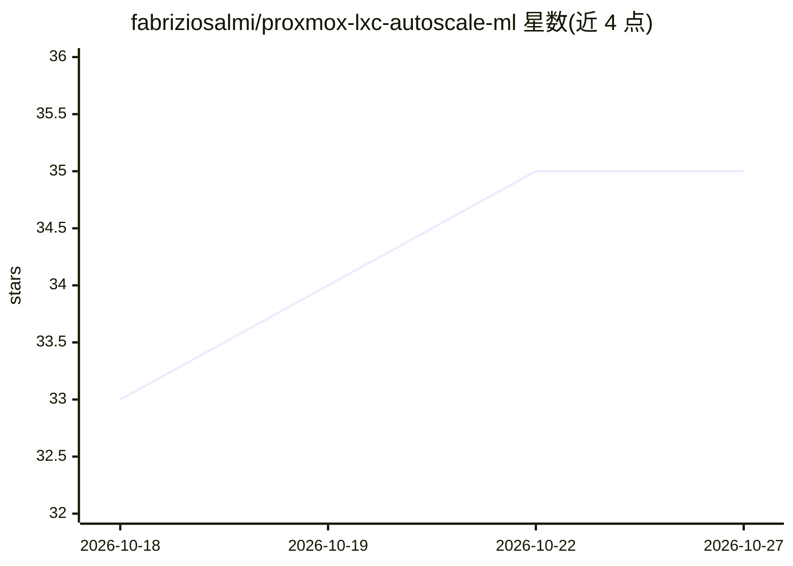

# fabriziosalmi/proxmox-lxc-autoscale-ml

⭐ 35 · Python · MIT · 推送 2026-10-21 · [GitHub](https://github.com/fabriziosalmi/proxmox-lxc-autoscale-ml) · [官网](https://fabriziosalmi.github.io/proxmox-lxc-autoscale-ml/) · 个人维护

**给 Proxmox 管理员：用机器学习自动伸缩 LXC 容器 CPU/内存**

运行在 Proxmox 宿主机上的三组件自动伸缩工具：Monitor 通过 pct exec 采集每容器 CPU/内存/交换/进程数/网络等指标写入 JSON 文件；Model 组件对每个容器自身历史训练 IsolationForest 异常检测模型，按步长在上限下限之间决定资源增减；API 组件以 root 运行 gunicorn，封装 pct 提供缩放、快照、克隆等 REST 端点。支持 dry_run、置信度阈值、熔断器与 Prometheus 指标导出。限制：仅支持 IsolationForest、不做磁盘自动扩容、不迁移容器；默认配置下 API 鉴权关闭且监听全部接口。在 Proxmox VE 8（Debian 12）开发与测试。

## 筛选速览

| 维度 | 判定 | 备注 |
|---|---|---|
| AI 角色 | `ai-native` | 本体是模型或模型工具 |
| 许可风险 | `permissive` | MIT |
| 部署形态 | `library` | 以包/库形式分发 |
| 模型依赖 | — | README 未给出锁定关系 |
| 硬件要求 | — | 无带数字的原话,不猜 |
| 安装摩擦 | `low` | 无编译、无系统依赖或容器化 |
| 成熟度 | — | 结构信号不足 |

## 能力要点

- 每容器独立训练 IsolationForest，异常相对该容器自身历史判定
- 通过 pct set 调整 CPU/内存，不重启容器
- dry_run 演练、置信度阈值、API 熔断器与指数退避
- Prometheus 指标导出与可选 API key 鉴权、按 IP 限流

## 适用场景

- Proxmox 宿主机上自动增减 LXC 容器的 CPU 与内存配额
- 以 dry_run 先演练伸缩决策再实际应用
- 在 Prometheus 中监控伸缩动作与容器资源分配

## 场景标签

`工作流自动化` · 领域:效率与自动化

## 证据(README 行号)

> L3: **LXC AutoScale ML** adjusts the CPU and memory allocated to Proxmox LXC
> L40: - **Learns per container.** An IsolationForest is trained on each container's
> L203: - **IsolationForest**, retrained each cycle on the full history in the file, to

## 星数曲线

2026-10-18 33 → 2026-10-27 35（+2）

---
*卡片 v1 · prompt 1.4 · 生成 2026-10-25 · 置信度 mid · 依据 README sha `d32b03fea2ce` · [字段定义](../../DATASET.md)*
