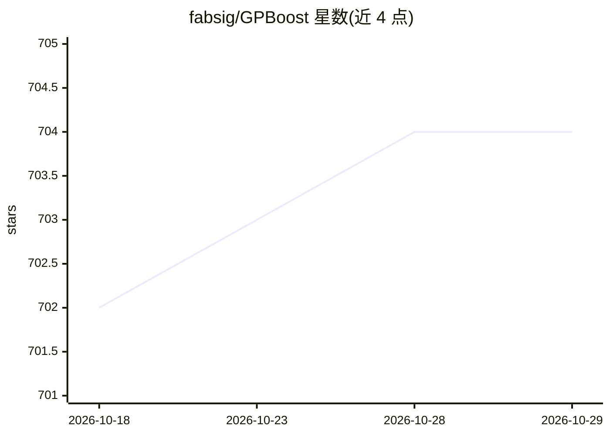

# fabsig/GPBoost

⭐ 704 · C++ · NOASSERTION · 推送 2026-10-26 · [GitHub](https://github.com/fabsig/GPBoost) · 个人维护

**结合树提升与高斯过程/混合效应模型的机器学习库**

GPBoost 是以 C++ 为主实现的建模库，提供 Python 与 R 包及 C 接口和 CLI 版本。核心是 GPBoost/LaGaBoost 算法：将梯度树提升与高斯过程、分组随机效应等潜高斯模型结合，支持多种似然、协方差函数与可扩展 GP 近似；也可单独使用 LMM/GLMM、高斯过程或树提升。适用于空间/时空数据、高基数分类变量、纵向与面板数据等带依赖结构的表格数据建模场景。方法论发表于 JMLR 2022 与 TPAMI 2023。

## 筛选速览

| 维度 | 判定 | 备注 |
|---|---|---|
| AI 角色 | `ai-native` | 本体是模型或模型工具 |
| 许可风险 | `none` | NOASSERTION |
| 部署形态 | `desktop` | 安装包/桌面程序 |
| 模型依赖 | — | README 未给出锁定关系 |
| 硬件要求 | — | 无带数字的原话,不猜 |
| 安装摩擦 | `low` | 无编译、无系统依赖或容器化 |
| 成熟度 | — | 结构信号不足 |

## 能力要点

- 树提升与高斯过程/随机效应模型的结合算法（GPBoost/LaGaBoost）
- 支持多种似然、GP 协方差函数与可扩展 GP 近似
- 提供 Python 包、R 包、C 接口与 CLI
- 配套 JMLR/TPAMI 论文与 Python/R 示例

## 适用场景

- 对空间或时空数据做带不确定性量化的预测
- 建模含分组/嵌套/交叉随机效应的纵向与面板数据
- 处理高基数分类变量的表格数据预测

## 场景标签

 · 领域:机器学习/统计建模

## 证据(README 行号)

> L11: **GPBoost is a software library for tree-boosting, Gaussian processes, and mixed-effects models (aka latent Gaussia
> L36: ## Modeling background

## 星数曲线

2026-10-18 702 → 2026-10-29 704（+2）

---
*卡片 v1 · prompt 1.4 · 生成 2026-10-21 · 置信度 high · 依据 README sha `3a98abf908ae` · [字段定义](../../DATASET.md)*
