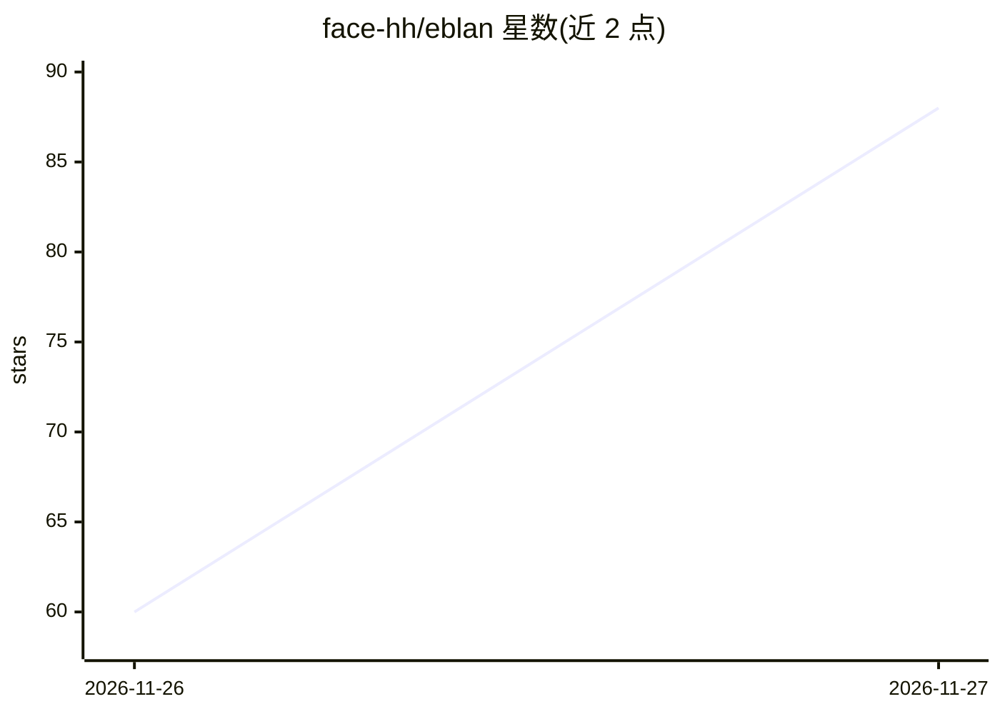

# face-hh/eblan

⭐ 88 · Python · NOASSERTION · 推送 2026-11-24 · [GitHub](https://github.com/face-hh/eblan) · [官网](https://eblan.basaltlabs.org) · 个人维护

**用 CS2 游戏聊天训练的娱乐用毒性聊天机器人及其基准**

EBLAN 是在 Counter-Strike 2 对局聊天上训练的小型语言模型，基于 Qwen3.5-4B-Base 的 LoRA，经多轮后训练使其尽量产生毒性回复，用途仅为娱乐且内容 18+。仓库提供毒性基准（450 条侮辱语料、提示词及 LLM 评委打分脚本）与训练流水线代码；模型权重与聊天数据集未发布，推理仅在网站限时开放。安装与运行流程在 README 中未给出。

## 筛选速览

| 维度 | 判定 | 备注 |
|---|---|---|
| AI 角色 | `ai-native` | 本体是模型或模型工具 |
| 许可风险 | `none` | NOASSERTION |
| 部署形态 | `None` |  |
| 模型依赖 | — | README 未给出锁定关系 |
| 硬件要求 | — | 无带数字的原话,不猜 |
| 安装摩擦 | `low` | 无编译、无系统依赖或容器化 |
| 成熟度 | — | 结构信号不足 |

## 能力要点

- 基于 Qwen3.5-4B-Base 的 LoRA 微调，多轮后训练提升毒性
- 包含 450 条侮辱语料与 LLM 评委打分的毒性基准
- 训练中对单一脏词出现频率做上限控制以避免回复重复
- 代码采用 MIT 许可，侮辱语料沿用其原始来源条款

## 适用场景

- 复现游戏聊天语料的训练流水线
- 使用该基准对模型毒性回复做 LLM 评委打分
- 在网站限时体验文本或语音对话

## 场景标签

`聊天机器人` `微调` `模型评测` · 领域:对话与助手

## 证据(README 行号)

> L7: EBLAN is a small language model trained on Counter-Strike 2 match chat. It's a LoRA on Qwen3.5-4B-Base, refined to b
> L9: You can talk to it on the website, for a limited time, by text or by voice. It's made for entertainment only, and it
> L28: - `benchmark/` is the toxicity benchmark - 450 insults, the prompts, and a script that runs a model through them an

## 星数曲线

2026-11-26 60 → 2026-11-27 88（+28）

---
*卡片 v1 · prompt 1.4 · 生成 2026-11-26 · 置信度 high · 依据 README sha `5f7452d9c37b` · [字段定义](../../DATASET.md)*
