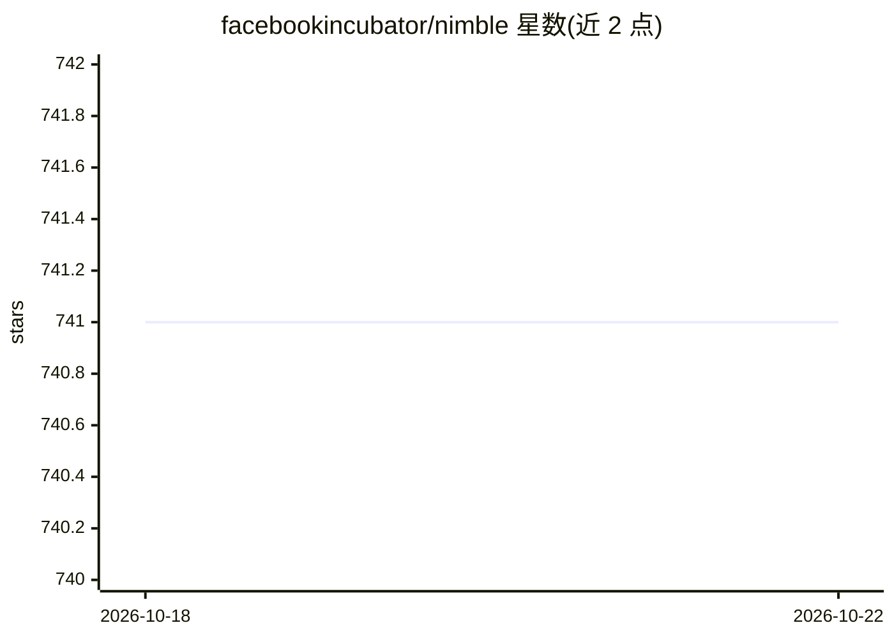

# facebookincubator/nimble

⭐ 741 · C++ · Apache-2.0 · 推送 2026-09-21 · [GitHub](https://github.com/facebookincubator/nimble) · 组织维护

**面向宽表/机器学习训练数据的大规模列式文件格式**

Meta（原 Alpha 项目）开发的列式文件格式，定位为 Apache Parquet 与 ORC 的替代，面向数千到数万列的特征工程与机器学习训练表。机制上：编码与物理布局解耦，允许用户扩展编码并递归级联组合；使用 FlatBuffers 组织元数据、块编码提供可预测内存；设计上支持 SIMD/GPU 友好的并行编码（尚未实现）。以单一统一 C++ 库形式提供而非纯规范，需从源码用 CMake/Make 编译，当前与 Velox 紧耦合，尚无稳定性与版本化保证。

## 筛选速览

| 维度 | 判定 | 备注 |
|---|---|---|
| AI 角色 | `ai-enhanced` | 去掉 AI 部分产品仍成立 |
| 许可风险 | `permissive` | Apache-2.0 |
| 部署形态 | `None` |  |
| 模型依赖 | — | README 未给出锁定关系 |
| 硬件要求 | — | 无带数字的原话,不猜 |
| 安装摩擦 | `medium` | 含编译或系统依赖之一 |
| 成熟度 | `idea` | |

## 能力要点

- 编码与物理布局解耦，支持用户扩展与级联（递归组合）编码
- 元数据用 FlatBuffers 组织，支持数千到数万列/流
- 块编码提供解码时可预测的内存使用
- 单一统一库形式提供，不鼓励第三方按规范重新实现

## 适用场景

- 存储包含数千列的特征工程与机器学习训练表
- 需要自定义或扩展数据编码方案的大规模数据集存储
- 在 Velox 生态中替代 Parquet/ORC 做列式数据读取

## 场景标签

 · 领域:数据系统/存储

## 证据(README 行号)

> L14: - **Wide:** Nimble is better suited for workloads that are wide in nature, such
> L16:  feature engineering workloads and training tables for machine learning.

## 星数曲线

2026-10-18 741 → 2026-10-22 741（+0）

---
*卡片 v1 · prompt 1.4 · 生成 2026-10-21 · 置信度 mid · 依据 README sha `2d737bee19e6` · [字段定义](../../DATASET.md)*
