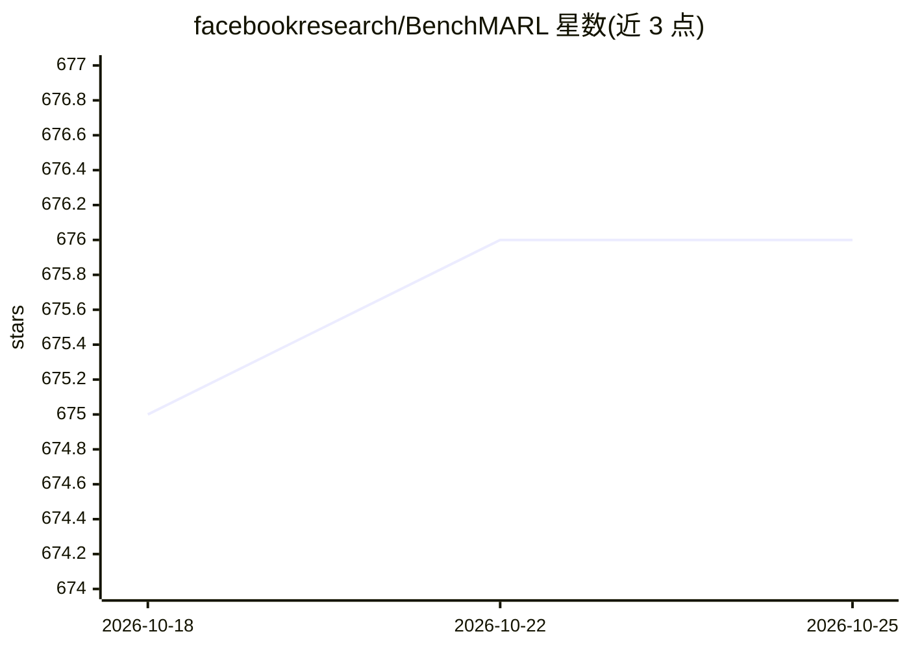

# facebookresearch/BenchMARL

⭐ 676 · Python · MIT · 推送 2026-02-07 · [GitHub](https://github.com/facebookresearch/BenchMARL) · [官网](https://benchmarl.readthedocs.io) · 组织维护

**多智能体强化学习（MARL）训练与基准测试库**

基于 TorchRL 后端的 MARL 训练库，用于在不同 MARL 算法、环境与模型之间做可复现、标准化的公平比较。通过 hydra 做模块化配置，实验与算法/任务/模型选择解耦，可用一行命令或多运行（multi-run）批量启动对比实验，支持顺序、并行与 slurm 启动器。内置 9 种算法（MAPPO/QMIX/MASAC 等）、6 类环境（VMAS/SMACv2/MPE 等）与 MLP/GNN/LSTM 等模型，报告兼容 marl-eval。面向 MARL 研究者与算法开发者，通过抽象接口可扩展自定义算法、任务和模型。

## 筛选速览

| 维度 | 判定 | 备注 |
|---|---|---|
| AI 角色 | `ai-native` | 本体是模型或模型工具 |
| 许可风险 | `permissive` | MIT |
| 部署形态 | `library` | 以包/库形式分发 |
| 模型依赖 | — | README 未给出锁定关系 |
| 硬件要求 | — | 无带数字的原话,不猜 |
| 安装摩擦 | `low` | 无编译、无系统依赖或容器化 |
| 成熟度 | — | 结构信号不足 |

## 能力要点

- 9 种 MARL 算法（MAPPO/IPPO/MADDPG/QMIX/MASAC 等）统一实现
- 6 类环境（VMAS 27 任务、MeltingPot 49 任务等）可选安装
- hydra 模块化配置，支持命令行/脚本/多运行/slurm 启动
- 报告与绘图兼容 marl-eval，提供调优超参数脚本与公开基准

## 适用场景

- 我想把自己的 MARL 新算法与现有算法做公平对比
- 一行代码跨算法、任务、模型批量跑基准实验
- 用标准接口快速接入自定义环境或模型并复现实验

## 场景标签

`模型评测` `强化学习` · 领域:评测与运维

## 证据(README 行号)

> L24: BenchMARL is a Multi-Agent Reinforcement Learning (MARL) training library created to enable reproducibility
> L162: BenchMARL is a full-pipline unified training library with the goal of enabling users to run
> L174: **Experiment**. An experiment is a training run in which an algorithm, a task, and a model are fixed.

## 星数曲线

2026-10-18 675 → 2026-10-25 676（+1）

---
*卡片 v1 · prompt 1.4 · 生成 2026-10-21 · 置信度 high · 依据 README sha `6a78746ebfa3` · [字段定义](../../DATASET.md)*
