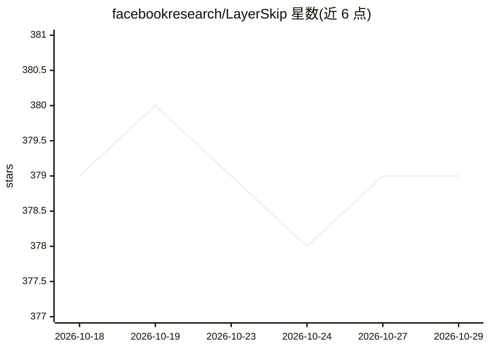

# facebookresearch/LayerSkip

⭐ 379 · Python · NOASSERTION · 推送 2026-07-20 · [GitHub](https://github.com/facebookresearch/LayerSkip) · 组织维护

**LLM 早退推理与自投机解码的研究实现及模型检查点**

ACL 2024 论文 LayerSkip 的官方代码库：通过训练配方使 LLM 支持早退推理，并以同一模型的不同层作为草稿与验证阶段实现自投机解码加速。提供 7 个经 LayerSkip 配方持续预训练的 Llama 系列检查点（需在 HuggingFace 申请访问），并附带生成、基准测试、评测（集成 Eleuther Harness）、超参扫描与正确性校验脚本。训练实现标注为进行中；另有 gpt-fast 与 HuggingFace 两种其他推理实现。许可证为 CC BY-NC（非商用）。

## 筛选速览

| 维度 | 判定 | 备注 |
|---|---|---|
| AI 角色 | `ai-native` | 本体是模型或模型工具 |
| 许可风险 | `none` | NOASSERTION |
| 部署形态 | `library` | 以包/库形式分发 |
| 模型依赖 | — | README 未给出锁定关系 |
| 硬件要求 | — | 无带数字的原话,不猜 |
| 安装摩擦 | `low` | 无编译、无系统依赖或容器化 |
| 成熟度 | `idea` | |

## 能力要点

- 自投机解码：早退层作草稿、完整模型验证，提升推理速度
- 7 个 Llama/Llama3 系列开源检查点（需 HuggingFace 申请访问）
- 提供 generate/benchmark/eval/sweep/correctness 全套脚本
- 推理已集成进 HuggingFace transformers，训练配方进入 torchtune 与 trl

## 适用场景

- 研究者复现论文中的推理加速实验
- 在自托管 Llama 模型上测试自投机解码加速效果
- 基于 gpt-fast 实现将 LayerSkip 与量化、torch.compile 等优化叠加

## 场景标签

`推理引擎` `模型训练` · 领域:训练与推理

## 证据(README 行号)

> L4: This code base is the implementation of LayerSkip: Enabling Early Exit Inference and Self-Speculative Decoding.
> L55: In order to observe speedup, you need to use self-speculative decoding to generate tokens, and specify `--exit_laye
> L57: $ torchrun generate.py --model facebook/layerskip-llama2-7B \

## 星数曲线

2026-10-18 379 → 2026-10-29 379（+0）

---
*卡片 v1 · prompt 1.4 · 生成 2026-10-21 · 置信度 mid · 依据 README sha `cc1e60c89872` · [字段定义](../../DATASET.md)*
