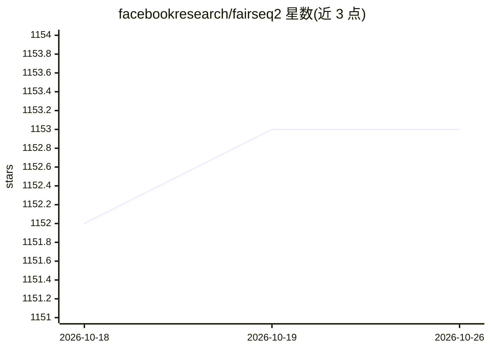

# facebookresearch/fairseq2

⭐ 1,153 · Python · MIT · 推送 2026-10-21 · [GitHub](https://github.com/facebookresearch/fairseq2) · [官网](https://facebookresearch.github.io/fairseq2/) · 组织维护

**面向研究者的序列建模工具包：训练自定义内容生成模型**

FAIR 开源的序列建模工具包，是原 fairseq 的从零重写版本，供研究人员训练用于内容生成任务的自定义模型。提供语言模型指令微调与偏好优化的一方 recipe，支持 DDP/FSDP/张量并行的多 GPU 多节点训练（可训练 70B+ 模型），内置采样与束搜索序列生成器，并原生支持 vLLM。采用可扩展、低侵入的模块化架构，研究者可独立持有项目代码库。预编译包覆盖 Linux x86-64 与 macOS ARM64，Windows 仅能通过 WSL 使用；PyTorch C++ API 无 ABI 兼容，必须安装与 PyTorch 版本精确匹配的变体。

## 筛选速览

| 维度 | 判定 | 备注 |
|---|---|---|
| AI 角色 | `ai-ecosystem` | LLM/agent 周边工具 |
| 许可风险 | `permissive` | MIT |
| 部署形态 | `desktop` | 安装包/桌面程序 |
| 模型依赖 | local-ok | 支持本地模型 |
| 硬件要求 | — | 无带数字的原话,不猜 |
| 安装摩擦 | `medium` | 含编译或系统依赖之一 |
| 成熟度 | — | 结构信号不足 |

## 能力要点

- 语言模型指令微调与偏好优化的一方 recipe
- DDP/FSDP/张量并行多 GPU 多节点训练，支持 70B+ 模型
- 原生支持 vLLM 及内置采样/束搜索序列生成器
- C++ 实现的流式高吞吐数据管道（含语音解码）

## 适用场景

- 研究者训练自定义序列生成模型
- 对大语言模型做指令微调与偏好优化
- 在多 GPU/多节点集群上训练 70B 以上模型

## 场景标签

`微调` `模型训练` · 领域:训练与推理

## 证据(README 行号)

> L9: fairseq2 is a sequence modeling toolkit that allows researchers to train custom models for content generation tasks.
> L26: * First-party recipes for language model instruction finetuning and preference optimization
> L27: * Multi-GPU, multi-node training using DDP, FSDP, and tensor parallelism. Supports 70B+ models.

## 星数曲线

2026-10-18 1,152 → 2026-10-26 1,153（+1）

---
*卡片 v1 · prompt 1.4 · 生成 2026-10-21 · 置信度 high · 依据 README sha `b5777b72a3ff` · [字段定义](../../DATASET.md)*
