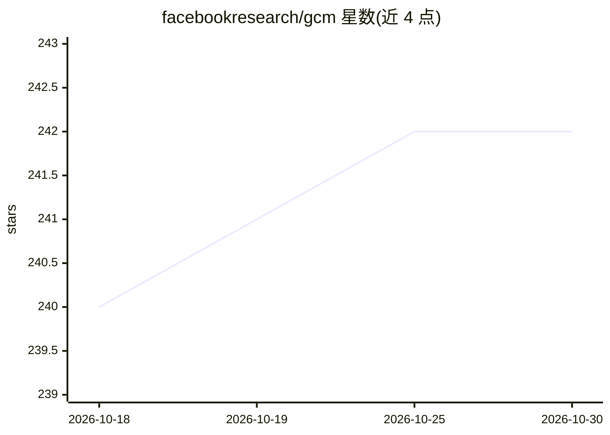

# facebookresearch/gcm

⭐ 242 · Python · MIT · 推送 2026-10-20 · [GitHub](https://github.com/facebookresearch/gcm) · [官网](https://facebookresearch.github.io/gcm/) · 组织维护

**面向 HPC 集群的 GPU 大规模监控工具集**

Meta FAIR 开源的 GPU 集群监控工具集，用于支撑数十万 GPU 规模的 AI 研究负载。单体仓库含三部分：从 Slurm 调度器采集集群统计的 Monitoring；覆盖硬件/软件/网络/存储/服务的 Health Checks；以及将遥测数据与 Slurm 元数据关联、把 GPU 指标归属到具体作业和用户的 Telemetry Processor。文档中列出对更多 GPU 类型（AMD/Intel）与其他调度器的扩展方向。各组件独立许可。

## 筛选速览

| 维度 | 判定 | 备注 |
|---|---|---|
| AI 角色 | `ai-ecosystem` | LLM/agent 周边工具 |
| 许可风险 | `permissive` | MIT |
| 部署形态 | `None` |  |
| 模型依赖 | — | README 未给出锁定关系 |
| 硬件要求 | — | 无带数字的原话,不猜 |
| 安装摩擦 | `low` | 无编译、无系统依赖或容器化 |
| 成熟度 | — | 结构信号不足 |

## 能力要点

- 从 Slurm 调度器采集集群统计与资源利用率
- 作业全生命周期的硬件/软件/网络/存储健康检查
- 将 OpenTelemetry 遥测与 Slurm 元数据关联，指标归属到作业与用户

## 适用场景

- 大规模 GPU 集群的作业性能与资源利用率监控
- AI 训练集群的硬件与网络健康检查
- 将 GPU 利用率等遥测指标归因到具体作业和用户

## 场景标签

`MLOps` · 领域:训练与推理

## 证据(README 行号)

> L5: GCM is a set of tools used to do at-scale monitoring for HPC (High-Performance Computing) clusters, it powers Meta F
> L9: - Monitoring: Collects cluster statistics from the Slurm workload scheduler, providing visibility into job performan
> L11: - Telemetry Processor / GPU Metrics: Enhances OpenTelemetry data by correlating telemetry with Slurm metadata, enab

## 星数曲线

2026-10-18 240 → 2026-10-30 242（+2）

---
*卡片 v1 · prompt 1.4 · 生成 2026-10-22 · 置信度 high · 依据 README sha `b469c38f5dc1` · [字段定义](../../DATASET.md)*
