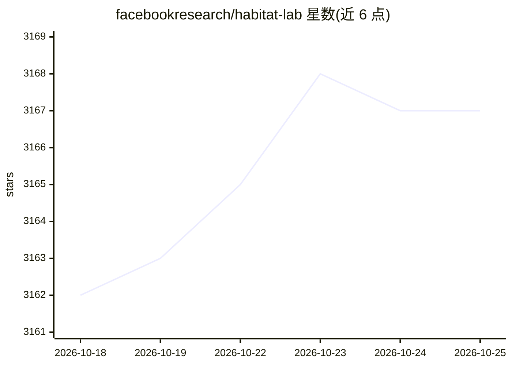

# facebookresearch/habitat-lab

⭐ 3,167 · Python · MIT · 推送 2026-05-07 · [GitHub](https://github.com/facebookresearch/habitat-lab) · [官网](https://aihabitat.org/) · 组织维护

**训练具身智能体的模块化高层库：室内仿真任务端到端开发**

面向具身 AI 研究者的 Python 库，基于 Habitat-Sim 仿真器，支持定义单/多智能体任务（导航、重排、指令跟随、问答、人体跟随等）、配置包含商用机器人和人形机器人在内的具身智能体、通过模仿学习/强化学习（含 PPO 基线）或无学习的 SensePlanAct 流程训练并评测智能体，并提供人机交互框架用于采集具身数据。限制：v0.3.4 之后 Meta 内部团队不再官方维护；Docker 容器需要 NVIDIA GPU 与 nvidia-docker。

## 筛选速览

| 维度 | 判定 | 备注 |
|---|---|---|
| AI 角色 | `ai-native` | 本体是模型或模型工具 |
| 许可风险 | `permissive` | MIT |
| 部署形态 | `self-host` | docker 或自建部署 |
| 模型依赖 | — | README 未给出锁定关系 |
| 硬件要求 | — | 无带数字的原话,不猜 |
| 安装摩擦 | `low` | 无编译、无系统依赖或容器化 |
| 成熟度 | — | 结构信号不足 |

## 能力要点

- 灵活的单/多智能体任务定义（导航、重排、指令跟随、问答等）
- 模仿学习、强化学习（PPO 基线）与 SensePlanAct 训练评测算法
- 人机交互框架，支持采集具身数据或与训练后智能体交互
- 提供 Docker 容器与 gym 接口（habitat.gym）

## 适用场景

- 在室内仿真环境中训练导航或重排任务的机器人智能体
- 用标准指标对具身智能体做基准评测
- 通过 ROS-X-Habitat 桥接 ROS 与 Habitat 做机器人研究
- 参与 Habitat Challenge 等具身 AI 竞赛

## 场景标签

`强化学习` `模型评测` · 领域:评测与运维

## 证据(README 行号)

> L16: Habitat-Lab is a modular high-level library for end-to-end development in embodied AI. It is designed to train agen
> L22: - **Training and evaluating agents**: providing algorithms for single and multi-agent training (via imitation or re

## 星数曲线

2026-10-18 3,162 → 2026-10-25 3,167（+5）

---
*卡片 v1 · prompt 1.4 · 生成 2026-10-20 · 置信度 high · 依据 README sha `565abd561413` · [字段定义](../../DATASET.md)*
