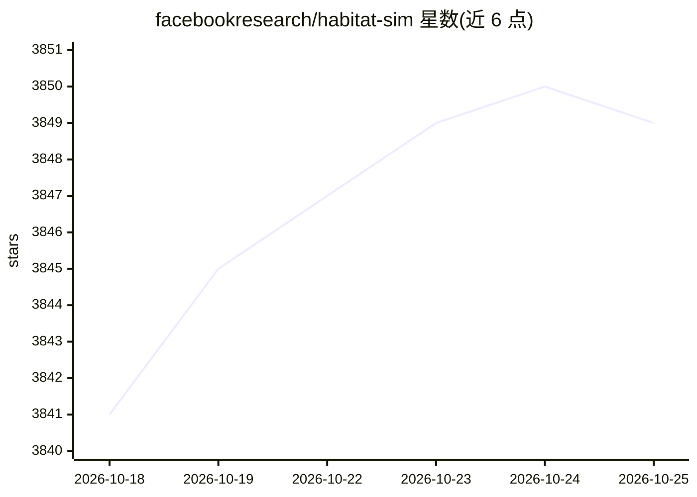

# facebookresearch/habitat-sim

⭐ 3,849 · C++ · MIT · 推送 2026-07-21 · [GitHub](https://github.com/facebookresearch/habitat-sim) · [官网](https://aihabitat.org/) · 组织维护

**面向具身智能研究的 3D 物理仿真平台**

C++/Python 实现的 3D 仿真器，支持室内外三维扫描数据集（HM3D、MatterPort3D、Gibson 等）、CAD 物体模型、可配置 RGB-D 传感器、URDF 机器人描述与 Bullet 刚体物理，供具身智能研究训练与评测智能体使用，通常配合高层库 Habitat-Lab 完成导航、指令跟随等任务。提供 Conda/PIP/Docker/源码四种安装方式，含交互式 viewer。注意：v0.3.4 之后 Meta 内部团队已停止官方开发维护。

## 筛选速览

| 维度 | 判定 | 备注 |
|---|---|---|
| AI 角色 | `ai-ecosystem` | LLM/agent 周边工具 |
| 许可风险 | `permissive` | MIT |
| 部署形态 | `library` | 以包/库形式分发 |
| 模型依赖 | — | README 未给出锁定关系 |
| 硬件要求 | — | 无带数字的原话,不猜 |
| 安装摩擦 | `medium` | 含编译或系统依赖之一 |
| 成熟度 | `idea` | |

## 能力要点

- 单 GPU 多进程渲染超 10,000 FPS，Fetch 机器人仿真超 8,000 SPS
- 内置 HM3D/HSSD/MatterPort3D/Gibson/Replica 等数据集支持
- URDF 机器人 + Bullet 刚体/关节体物理仿真
- 提供 C++/Python 交互式 viewer 与示例脚本

## 适用场景

- 具身智能任务的导航与交互仿真实验
- 机器人操控策略的训练与评测
- 加载三维扫描场景进行传感器与物理仿真测试

## 场景标签

 · 领域:机器人/具身智能仿真

## 证据(README 行号)

> L16: A high-performance physics-enabled 3D simulator with support for:
> L25: Habitat-Sim is typically used with
> L26: Habitat-Lab, a modular high-level library for end-to-end experiments in embodied AI -- defining embodied AI tasks (

## 星数曲线

2026-10-18 3,841 → 2026-10-25 3,849（+8）

---
*卡片 v1 · prompt 1.4 · 生成 2026-10-20 · 置信度 mid · 依据 README sha `e0df0bde1ea6` · [字段定义](../../DATASET.md)*
