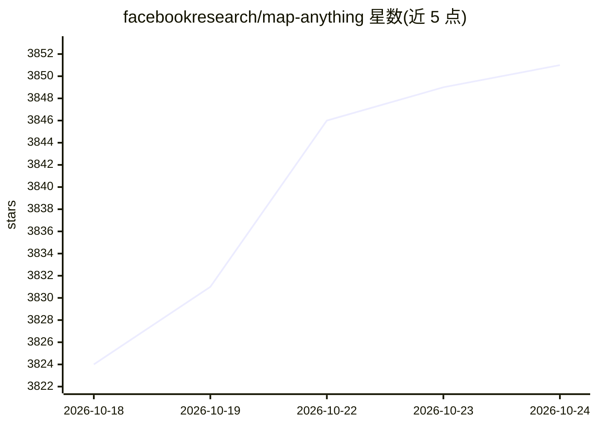

# facebookresearch/map-anything

⭐ 3,851 · Python · Apache-2.0 · 推送 2026-08-07 · [GitHub](https://github.com/facebookresearch/map-anything) · 组织维护

**通用度量 3D 重建研究框架：单前馈模型支持 12+ 重建任务**

Meta 与 CMU 合作的开源研究框架，核心为端到端训练的 transformer 模型，直接回归场景的度量 3D 几何，支持多图 SfM、多视图立体重建、单目度量深度估计、配准、深度补全等 12+ 种任务。输入可灵活组合（图像、标定、位姿、深度，共 64 种配置）。提供数据处理、训练、推理与性能剖析的完整栈，通过统一接口可互换运行 VGGT、DUSt3R、MASt3R 等外部模型并输出统一格式以供基准比较。需从源码安装，依赖 PyTorch/CUDA（版本自选）。

## 筛选速览

| 维度 | 判定 | 备注 |
|---|---|---|
| AI 角色 | `ai-native` | 本体是模型或模型工具 |
| 许可风险 | `permissive` | Apache-2.0 |
| 部署形态 | `library` | 以包/库形式分发 |
| 模型依赖 | — | README 未给出锁定关系 |
| 硬件要求 | — | 无带数字的原话,不猜 |
| 安装摩擦 | `medium` | 含编译或系统依赖之一 |
| 成熟度 | — | 结构信号不足 |

## 能力要点

- 单一前馈模型支持 12+ 种 3D 重建任务
- 输入灵活组合（图像/标定/位姿/深度，64 种配置）
- 统一接口互换运行 VGGT、DUSt3R、MASt3R、π³ 等 14 个模型
- 提供 GPU 内存/速度剖析脚本与内存高效模式（140GB 上 2000 视图）

## 适用场景

- 从图像或多模态输入直接生成度量 3D 重建与深度图
- 统一格式下对比/基准测试多个 3D 重建模型
- 在 COLMAP 输出上运行 MVS 推理并导出 COLMAP/GLB
- 剖析不同模型在不同视图数下的 GPU 显存与速度

## 场景标签

 · 领域:计算机视觉/3D 重建

## 证据(README 行号)

> L46: MapAnything is an **open-source research framework** for universal metric 3D reconstruction. At its core is a simpl
> L48: The framework provides the **complete stack**—data processing, training, inference, and profiling—with a **modular 

## 星数曲线

2026-10-18 3,824 → 2026-10-24 3,851（+27）

---
*卡片 v1 · prompt 1.4 · 生成 2026-10-20 · 置信度 high · 依据 README sha `30cc9358d24b` · [字段定义](../../DATASET.md)*
