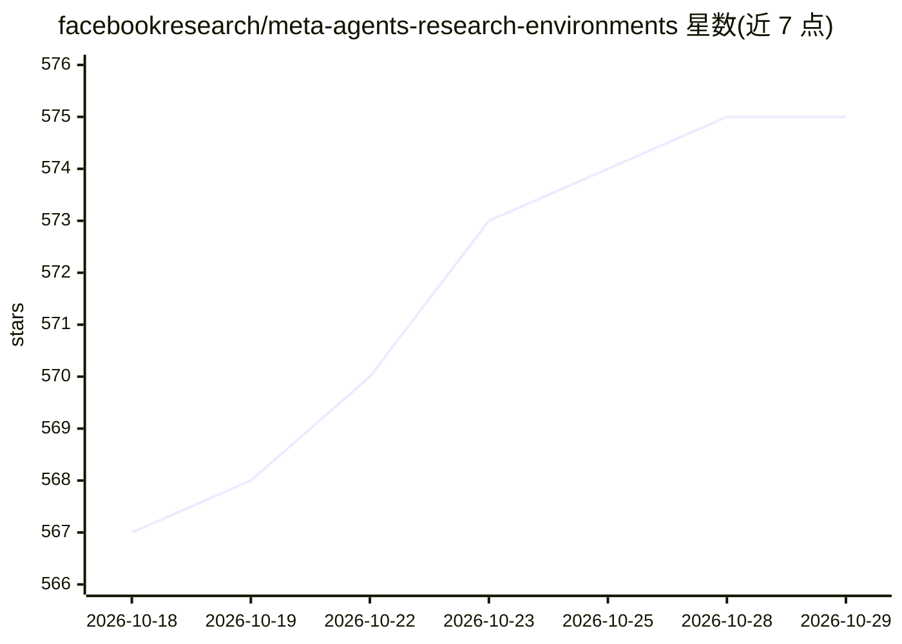

# facebookresearch/meta-agents-research-environments

⭐ 575 · Python · MIT · 推送 2026-09-30 · [GitHub](https://github.com/facebookresearch/meta-agents-research-environments) · [官网](https://facebookresearch.github.io/meta-agents-research-environments/) · 组织维护

**面向 AI agent 的动态环境评测平台，运行 Gaia2 基准**

Meta Agents Research Environments（ARE）是用于在动态、演化场景中评测 AI agent 的研究平台：环境随新信息出现而变化，任务需 10+ 步推理；平台运行 Gaia2 基准（800 个场景、10 个 universe），并有容器化 gaia2-cli 栈、多语言扩展 Omnilingual-Gaia2（10 种语言）与 Sequential Gaia2 链式场景。核心概念包括 agent（ReAct 框架）、app、event、scenario。模型接入通过 LiteLLM 支持多家 provider（如 Llama API），提供 CLI 与可选 Web GUI（pip [gui] 安装）。面向做 agent 评测与场景开发的研究者和开发者。

## 筛选速览

| 维度 | 判定 | 备注 |
|---|---|---|
| AI 角色 | `ai-ecosystem` | LLM/agent 周边工具 |
| 许可风险 | `permissive` | MIT |
| 部署形态 | `library` | 以包/库形式分发 |
| 模型依赖 | — | README 未给出锁定关系 |
| 硬件要求 | — | 无带数字的原话,不猜 |
| 安装摩擦 | `low` | 无编译、无系统依赖或容器化 |
| 成熟度 | — | 结构信号不足 |

## 能力要点

- 运行动态演化场景：新信息随时间注入，任务需 10+ 步推理
- Gaia2 基准 800 个场景、10 个 universe
- Omnilingual-Gaia2 多语言扩展（10 种语言）与 Sequential 链式场景
- 通过 LiteLLM 支持多家模型 provider，提供 CLI 与 Web GUI

## 适用场景

- 在 Gaia2 基准上评测我的 agent
- 开发带动态事件演化的自定义评测场景
- 用多语言或链式版本评测 agent 的适应能力

## 场景标签

`模型评测` · 领域:评测与运维

## 证据(README 行号)

> L9: Meta Agents Research Environments (ARE) is a platform designed to evaluate AI agents in dynamic, realistic scenarios
> L23: ARE addresses critical gaps in AI agent evaluation by providing:
> L35: |**Gaia2 Evaluation**|Build and evaluate your agents on the Gaia2 benchmark, a comprehensive suite of 800 dynamic s

## 星数曲线

2026-10-18 567 → 2026-10-29 575（+8）

---
*卡片 v1 · prompt 1.4 · 生成 2026-10-21 · 置信度 high · 依据 README sha `d5fb51d1b620` · [字段定义](../../DATASET.md)*
