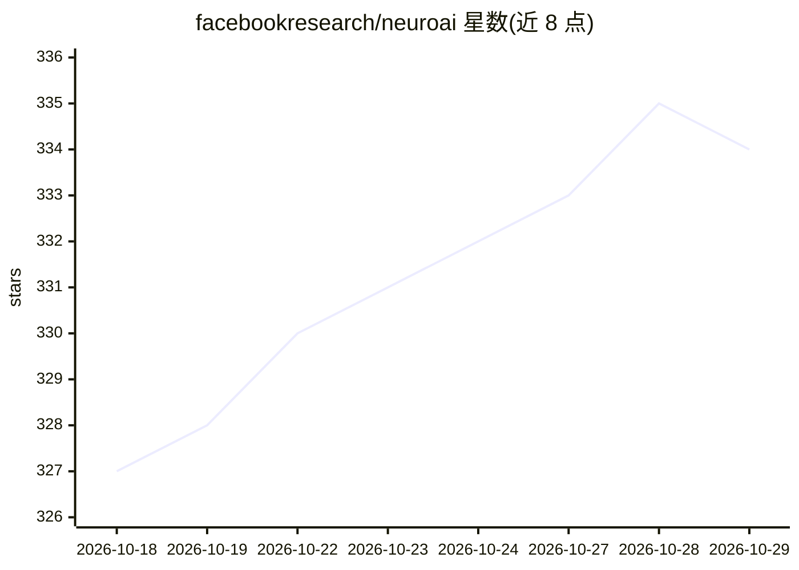

# facebookresearch/neuroai

⭐ 334 · Python · MIT · 推送 2026-10-28 · [GitHub](https://github.com/facebookresearch/neuroai) · [官网](https://facebookresearch.github.io/neuroai/) · 组织维护

**面向神经科学的 Python 工具套件：数据加载、数据集获取、训练与基准**

由 Meta（facebookresearch）维护的神经科学研究 Python 套件，覆盖多种数据模态，拆分为四个包：NeuralSet 提供高效数据加载器，NeuralFetch 获取精选神经科学数据集，NeuralTrain 支持大规模训练 NeuroAI 模型，NeuralBench 提供统一的模型基准测试。要求 Python 3.12+，各包均通过 pip 单独安装，MIT 许可，附带论文引用条目，相关项目 exca 为其执行与缓存框架。

## 筛选速览

| 维度 | 判定 | 备注 |
|---|---|---|
| AI 角色 | `ai-ecosystem` | LLM/agent 周边工具 |
| 许可风险 | `permissive` | MIT |
| 部署形态 | `library` | 以包/库形式分发 |
| 模型依赖 | — | README 未给出锁定关系 |
| 硬件要求 | — | 无带数字的原话,不猜 |
| 安装摩擦 | `low` | 无编译、无系统依赖或容器化 |
| 成熟度 | — | 结构信号不足 |

## 能力要点

- 四个子包分别覆盖数据加载、数据集获取、大规模训练与统一基准
- 各包独立 pip 安装（neuralset/neuralfetch/neuraltrain/neuralbench）
- 声明支持跨全部模态的神经科学研究

## 适用场景

- 神经科学研究者构建 NeuroAI 数据加载管线
- 获取精选神经科学数据集用于实验
- 大规模训练与基准测试 NeuroAI 模型

## 场景标签

`模型评测` `模型训练` · 领域:评测与运维

## 证据(README 行号)

> L14: ### NeuralSet
> L32: Train Neuro AI models at scale.
> L40: Unified benchmark for NeuroAI models.

## 星数曲线

2026-10-18 327 → 2026-10-29 334（+7）

---
*卡片 v1 · prompt 1.4 · 生成 2026-10-21 · 置信度 mid · 依据 README sha `8568b3218344` · [字段定义](../../DATASET.md)*
