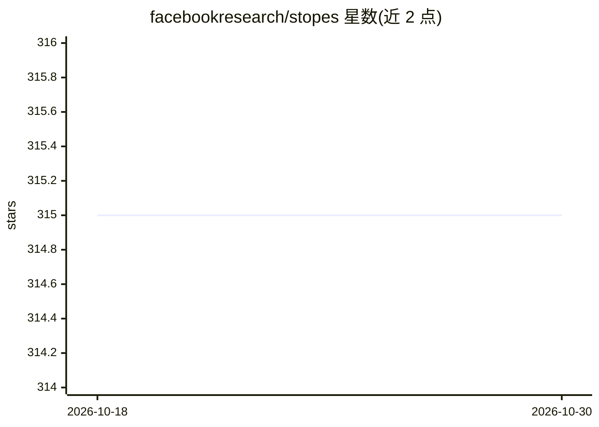

# facebookresearch/stopes

⭐ 315 · Python · MIT · 推送 2026-08-16 · [GitHub](https://github.com/facebookresearch/stopes) · [官网](https://facebookresearch.github.io/stopes/) · 组织维护

**机器翻译研究的数据准备库：清洗单语数据、挖掘双语平行句对**

FAIR NLLB 团队构建的机器翻译数据处理库，提供可扩展流水线框架（core）、常用处理模块（modules）及 NLLB 使用的数据流水线：单语数据清洗、基于 LASER 编码器的 bitext 双语句对挖掘（灵感来自 CCMatrix）、序列级知识蒸馏训练小模型，另含 ALTI+ 与 BLASER 等评测工具。面向机器翻译研究人员，依赖 fairseq、PyTorch，经 pip 源码安装，GPU 挖掘与 apex 加速为可选项。

## 筛选速览

| 维度 | 判定 | 备注 |
|---|---|---|
| AI 角色 | `ai-ecosystem` | LLM/agent 周边工具 |
| 许可风险 | `permissive` | MIT |
| 部署形态 | `library` | 以包/库形式分发 |
| 模型依赖 | — | README 未给出锁定关系 |
| 硬件要求 | — | 无带数字的原话,不猜 |
| 安装摩擦 | `low` | 无编译、无系统依赖或容器化 |
| 成熟度 | — | 结构信号不足 |

## 能力要点

- 单语数据清洗与 bitext 全局挖掘流水线
- 序列级知识蒸馏流水线（小模型从大教师模型训练）
- ALTI+ / BLASER 等文本无关语音翻译评测工具
- core 库支持编写可扩展数据处理流水线

## 适用场景

- 从网络数据构建干净的机器翻译训练语料
- 从两个单语数据集挖掘对齐的双语平行句对
- 为低资源语言翻译研究做数据准备与评测

## 场景标签

`模型评测` · 领域:评测与运维

## 证据(README 行号)

> L3: # `stopes`: A library for preparing data for machine translation research
> L82: - `bitext` to run the "global mining" pipeline and extract aligned sentences

## 星数曲线

2026-10-18 315 → 2026-10-30 315（+0）

---
*卡片 v1 · prompt 1.4 · 生成 2026-10-21 · 置信度 mid · 依据 README sha `0f3136859f34` · [字段定义](../../DATASET.md)*
