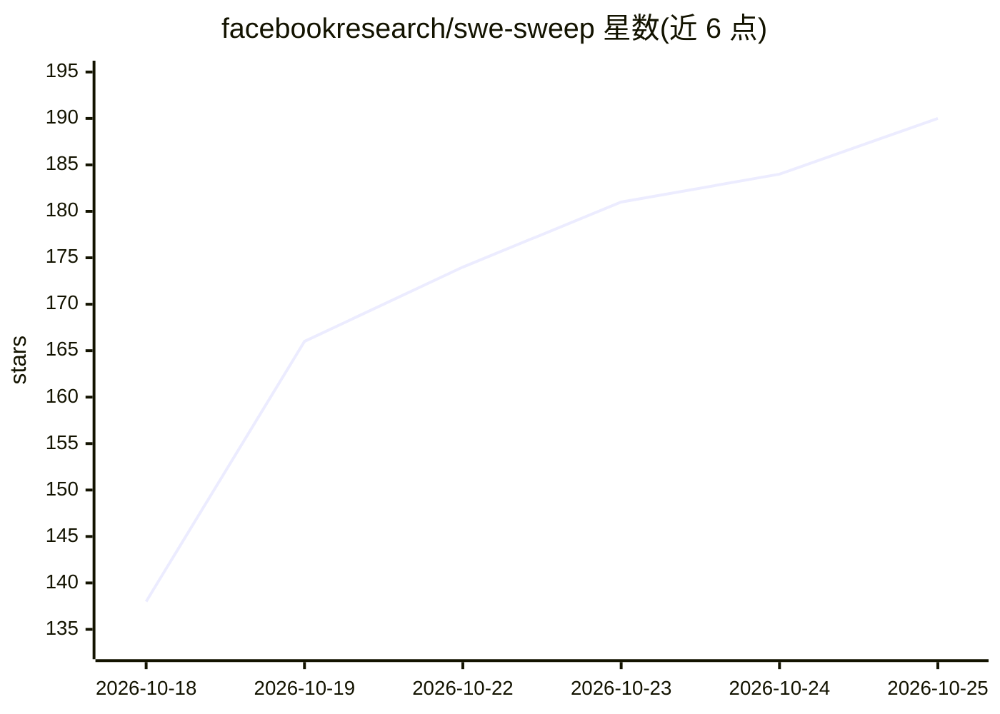

# facebookresearch/swe-sweep

⭐ 190 · Python · NOASSERTION · 推送 2026-10-23 · [GitHub](https://github.com/facebookresearch/swe-sweep) · [官网](https://swesweep.com) · 组织维护

**评测 LM agent 在大型代码库中自主发现并修复 bug 的基准**

Facebook Research 发布的软件工程 agent 基准：给定真实仓库，agent 需在不知道 bug 类型与位置的前提下自主发现并修复尽可能多的 bug，之后在独立验证环境中评测。本仓库代码是围绕 Harbor 框架的薄封装，因 Harbor 0.23 尚不支持分离的验证环境与 collect hooks，项目固定了 Harbor 源码仓库的兼容修订版本，待 0.24 发布。提供 sweep 命令行进行单任务评测、成绩汇总与微平均最终分数计算；CI 测试覆盖 Python 3.12/3.13。

## 筛选速览

| 维度 | 判定 | 备注 |
|---|---|---|
| AI 角色 | `ai-ecosystem` | LLM/agent 周边工具 |
| 许可风险 | `none` | NOASSERTION |
| 部署形态 | `library` | 以包/库形式分发 |
| 模型依赖 | — | README 未给出锁定关系 |
| 硬件要求 | — | 无带数字的原话,不猜 |
| 安装摩擦 | `low` | 无编译、无系统依赖或容器化 |
| 成熟度 | — | 结构信号不足 |

## 能力要点

- agent 无提示自主发现并修复真实仓库中的 bug
- 基于 Harbor 框架，在独立验证环境中评测结果
- 微平均最终分数（解决 bug 总数/bug 总数）计算
- 提供 sweep eval / sweep info 命令行工具

## 适用场景

- 评测 SWE agent 在大型代码库的自主找 bug 能力
- 用 diff 提交快速验证单任务修复结果
- 汇总多次评测结果并计算基准总分

## 场景标签

`模型评测` · 领域:评测与运维

## 证据(README 行号)

> L3:  How many bugs can LMs find & fix in large codebases?
> L5: Given a real repository, an agent must discover & repair as many bugs as they can.

## 星数曲线

2026-10-18 138 → 2026-10-25 190（+52）

---
*卡片 v1 · prompt 1.4 · 生成 2026-10-22 · 置信度 high · 依据 README sha `b1a88f84a6d8` · [字段定义](../../DATASET.md)*
