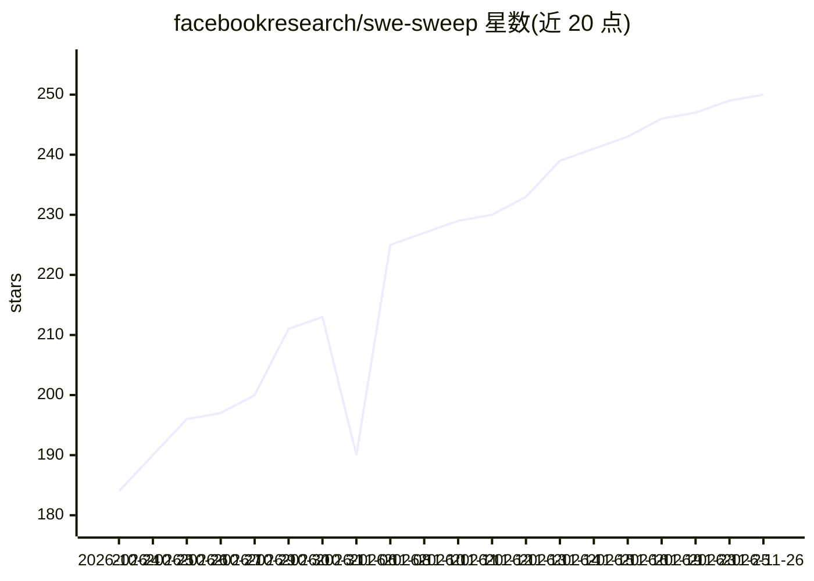

# facebookresearch/swe-sweep

⭐ 250 · Python · NOASSERTION · 推送 2026-11-12 · [GitHub](https://github.com/facebookresearch/swe-sweep) · [官网](https://swesweep.com) · 组织维护

**评测 LM agent 在真实仓库中发现并修复 bug 能力的基准**

SWE-sweep 是 Meta 研究团队发布的基准，考察语言模型 agent 在不给任何 bug 类型或位置提示的前提下，能在真实大型代码库中发现并修复多少 bug。本仓库是 harbor 框架之上的轻量封装：固定一个兼容版 Harbor 修订版，提供 uv/pip 安装、sweep infra doctor 环境自检、单任务评测命令与独立的 verifier 环境评分流程，最终按各任务解决 bug 数的微平均计算总分。评分公式、评测伪代码与引用信息均在 README 中给出。

## 筛选速览

| 维度 | 判定 | 备注 |
|---|---|---|
| AI 角色 | `ai-ecosystem` | LLM/agent 周边工具 |
| 许可风险 | `none` | NOASSERTION |
| 部署形态 | `library` | 以包/库形式分发 |
| 模型依赖 | — | README 未给出锁定关系 |
| 硬件要求 | — | 无带数字的原话,不猜 |
| 安装摩擦 | `low` | 无编译、无系统依赖或容器化 |
| 成熟度 | — | 结构信号不足 |

## 能力要点

- 给定真实仓库，agent 无提示自主发现并修复 bug
- 基于 harbor 框架，使用独立 verifier 环境验证提交补丁
- 总分按各任务 bug 解决数的微平均（加权平均）计算
- 提供 sweep eval/info 命令与任务级评测结果汇总

## 适用场景

- 评测我的 agent 在真实代码库中找修 bug 的能力
- 复现论文基准结果并按任务查看得分明细
- 为仓库维护者提供统一的基准提交与评分格式

## 场景标签

`模型评测` · 领域:评测与运维

## 证据(README 行号)

> L5: Given a real repository, an agent must discover & repair as many bugs as they can.
> L22: > * **Final score**: We build a micro-average of the bugs resolved (equivalent to a weighted average of the

## 星数曲线

2026-10-24 184 → 2026-11-26 250（+66）

---
*卡片 v1 · prompt 1.4 · 生成 2026-11-25 · 置信度 high · 依据 README sha `b95d292802cf` · [字段定义](../../DATASET.md)*
