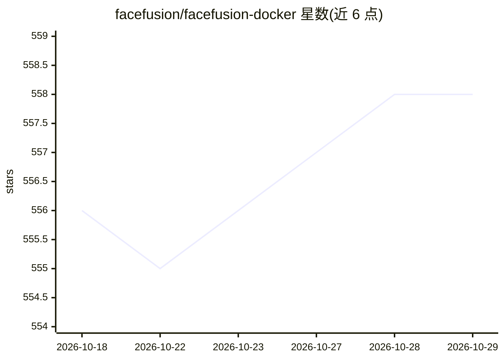

# facefusion/facefusion-docker

⭐ 558 · NOASSERTION · 推送 2026-10-27 · [GitHub](https://github.com/facefusion/facefusion-docker) · [官网](https://facefusion.io) · 组织维护

**FaceFusion 换脸/口型合成平台的 Docker 部署仓库**

提供 FaceFusion 人脸操控平台的容器化安装方式：通过 git clone 获取仓库，用 docker compose 分别启动 CPU、CUDA、TensorRT、ROCm 四种后端容器，各自映射到 7865-7880 不同端口，浏览器访问即用。README 本身不含模型与技术细节，指向外部文档做深入说明。面向希望在本地以容器方式运行 FaceFusion 并按硬件选择推理后端的用户。

## 筛选速览

| 维度 | 判定 | 备注 |
|---|---|---|
| AI 角色 | `ai-native` | 本体是模型或模型工具 |
| 许可风险 | `none` | NOASSERTION |
| 部署形态 | `self-host` | docker 或自建部署 |
| 模型依赖 | — | README 未给出锁定关系 |
| 硬件要求 | — | 无带数字的原话,不猜 |
| 安装摩擦 | `low` | 无编译、无系统依赖或容器化 |
| 成熟度 | — | 结构信号不足 |

## 能力要点

- 提供 CPU/CUDA/TensorRT/ROCm 四种 docker compose 配置
- 各后端容器分别映射独立端口（7865-7880）
- 以 Web UI 方式访问使用

## 适用场景

- 在本地以 Docker 快速部署 FaceFusion
- 按自有 GPU 硬件选择 CUDA/TensorRT/ROCm 推理后端
- 避免手动配置依赖环境

## 场景标签

`图像视频处理` · 领域:感知与多模态

## 证据(README 行号)

> L3: > Industry leading face manipulation platform.
> L23: docker compose -f docker-compose.cpu.yml up

## 星数曲线

2026-10-18 556 → 2026-10-29 558（+2）

---
*卡片 v1 · prompt 1.4 · 生成 2026-10-21 · 置信度 high · 依据 README sha `51e0b65b8cc5` · [字段定义](../../DATASET.md)*
