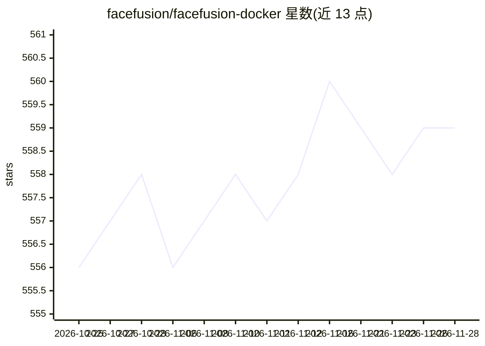

# facefusion/facefusion-docker

⭐ 559 · NOASSERTION · 推送 2026-10-27 · [GitHub](https://github.com/facefusion/facefusion-docker) · [官网](https://facefusion.io) · 组织维护

**面部替换与唇形同步平台的 Docker 部署镜像**

FaceFusion 的 Docker 封装，提供 CPU、CUDA、TensorRT、ROCm 四种 compose 配置，git clone 后用 docker compose 一键启动，通过 Web UI（不同后端对应不同本地端口）访问主平台的换脸、唇形同步等功能。README 本身不含功能说明，细节需查阅主项目文档。适合不想自行配置 Python 环境与 GPU 依赖的用户。

## 筛选速览

| 维度 | 判定 | 备注 |
|---|---|---|
| AI 角色 | `ai-native` | 本体是模型或模型工具 |
| 许可风险 | `none` | NOASSERTION |
| 部署形态 | `self-host` | docker 或自建部署 |
| 模型依赖 | — | README 未给出锁定关系 |
| 硬件要求 | — | 无带数字的原话,不猜 |
| 安装摩擦 | `low` | 无编译、无系统依赖或容器化 |
| 成熟度 | — | 结构信号不足 |

## 能力要点

- 提供 CPU/CUDA/TensorRT/ROCm 四种 docker compose 运行配置
- git clone 后 docker compose 即可启动
- Web UI 经本地端口访问（7865/7870/7875/7880）

## 适用场景

- 在容器中运行换脸与唇形同步工具
- 按 GPU 类型（CUDA/TensorRT/ROCm）选择镜像部署
- 避免本地配置依赖，用 Docker 隔离环境

## 场景标签

`图像视频处理` · 领域:感知与多模态

## 证据(README 行号)

> L3: > Industry leading face manipulation platform.
> L23: docker compose -f docker-compose.cpu.yml up
> L26: Run the `CUDA` container:

## 星数曲线

2026-10-25 556 → 2026-11-28 559（+3）

---
*卡片 v1 · prompt 1.4 · 生成 2026-11-26 · 置信度 high · 依据 README sha `2085abc8b358` · [字段定义](../../DATASET.md)*
