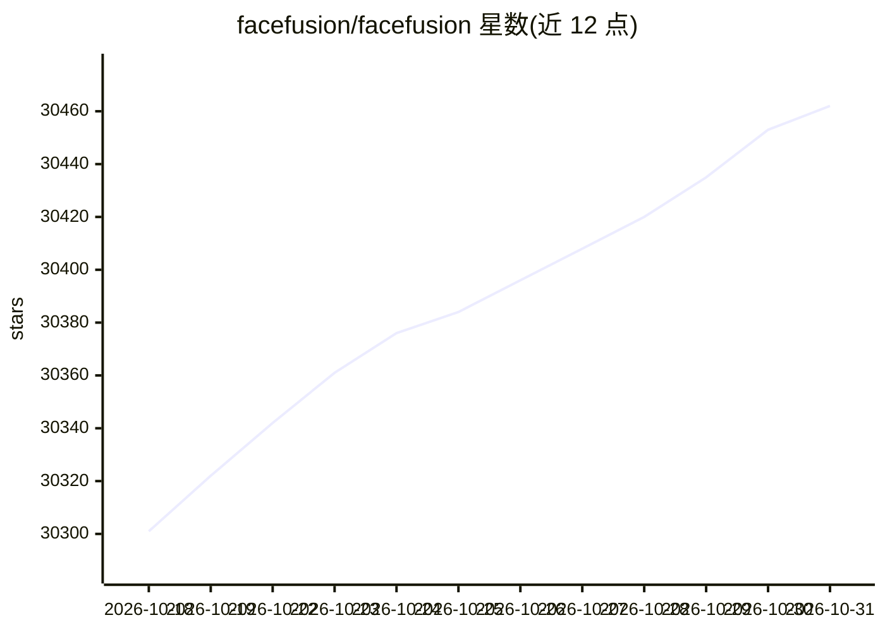

# facefusion/facefusion

⭐ 30,462 · Python · NOASSERTION · 推送 2026-10-30 · [GitHub](https://github.com/facefusion/facefusion) · [官网](https://facefusion.io) · 组织维护

**面向开发者的人脸换脸与唇形同步操作平台**

以 Python 入口（facefusion.py 命令行）运行的人脸操作平台，提供安装文档与使用文档；源码安装需要终端操作与技术能力，同时提供 Windows 与 macOS 安装器供不熟悉终端的用户使用。README 未展开具体功能细节，仅以主题标签（deepfake、face-swap、lip-sync 等）与描述表明其用途。

## 筛选速览

| 维度 | 判定 | 备注 |
|---|---|---|
| AI 角色 | `ai-native` | 本体是模型或模型工具 |
| 许可风险 | `none` | NOASSERTION |
| 部署形态 | `None` |  |
| 模型依赖 | — | README 未给出锁定关系 |
| 硬件要求 | — | 无带数字的原话,不猜 |
| 安装摩擦 | `low` | 无编译、无系统依赖或容器化 |
| 成熟度 | — | 结构信号不足 |

## 动量与使用信号

- 维护:`active` — 距上次 push 0.9 天,年发版 16,3 位贡献者
- 涨星:近 1 天 **+12**(自 20261016 起算)
- 安装:github 包 `release-assets` 月下载无数据
- 平台:WINDOWS / MACOS · 协议:—

## 能力要点

- 通过 python facefusion.py 命令行运行
- 提供 Windows 与 macOS 安装器
- 提供安装与深度使用文档

## 适用场景

- 安装后通过命令行执行人脸相关处理任务
- 不想用终端的用户使用 Windows/macOS 安装器起步

## 场景标签

`图像视频处理` · 领域:感知与多模态

## 证据(README 行号)

> L3: > Industry leading face manipulation platform.
> L15: Be aware, the installation needs technical skills and is not recommended for beginners. In case you are not comfort
> L22: python facefusion.py [commands] [options]

## 星数曲线

2026-10-18 30,301 → 2026-10-31 30,462（+161）

---
*卡片 v1 · prompt 1.4 · 生成 2026-10-18 · 置信度 mid · 依据 README sha `1aa9c9df5d39` · [字段定义](../../DATASET.md)*
